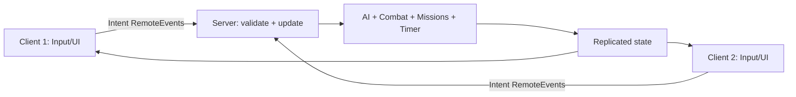

# Roblox technical architecture (planned)

## Data ownership
- **Workspace:** camera-visible map, NPC instances, physics crates/plates and triggers.
- **ReplicatedStorage:** shared constants and minimal RemoteEvents/state snapshots.
- **ServerScriptService:** authoritative AI, combat, missions, round clock and validation.
- **ServerStorage:** private NPC templates, restricted assets and authoritative prefabs.
- **StarterPlayerScripts:** player input/controller/camera and local sound/VFX.
- **StarterGui:** HUD/menu/results.

## Rojo file mapping
The `default.project.json` maps `src/shared` into `ReplicatedStorage/FNABKShared`, `src/server` into `ServerScriptService/FNABKServer`, and `src/client` into `StarterPlayer/StarterPlayerScripts/FNABKClient`. Do not create two sources of truth for any path. Studio-built map models can be stored as `.rbxm/.rbxmx` files under `assets/models` and reviewed as authored assets; avoid editing the same synced script in Studio and filesystem.

## Trust boundary

Never accept arbitrary damage/HP/Keys from clients. Validate target types, line of sight, maximum range, server cooldown, player alive and state. Use server timestamps for shared clock. Expose a deterministic state reset routine for tests. Module stubs provided in this repository are *not* gameplay implementation.

## Build boundary
`rojo build default.project.json -o build/FNABK.rbxlx` produces an initial place with synchronized scripts. Launch Studio and connect Rojo plugin with `rojo serve`; actual interactive physics/AI/network tests must run in Studio. The repository is **not** a replacement for shared Roblox Studio access: each developer needs appropriate permissions on the Roblox experience/place.

## AI agent boundary
Codex CLI may inspect local files by default. Studio interactions additionally require **official Roblox Studio MCP Quick Connect** locally; configuring GitHub or Rojo alone does not grant it access to an open Studio session. Require explicit approval for scene mutations, playtests and destructive operations.
