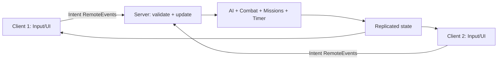

# Roblox technical architecture (planned)

> **Current design / implementation boundary:** [GDD.md](GDD.md) describes the selected five-day, 1–4-player survival direction. The architecture and implementation descriptions below primarily document the older A01 prototype. They are historical or existing-code descriptions, not evidence that the new survival systems, persistence or four-player play are implemented. New work must remain server-authoritative and follow [SURV acceptance criteria](ACCEPTANCE.md). CR-014 and instructor/team review track the design transition.

## Data ownership

`WaveComposition` assigns the selected grace-period creature/machine/Mimic totals and provisional normal-wave proportions. Wave enemies have distinct combat types and health but share prototype AI. Retreat moves toward an outward point, attempts a path around an obstacle, then dissolves; visibility-aware removal and map-wide navigation remain unfinished (CR-016). Studio assertions checked all four party-size compositions; a partial solo spawn snapshot contained all three visual types. Full spawn and behavior remain unverified (SURV-02/07/11).

The helicopter server refreshes physical boarding membership immediately before vote requests and departure; early departure sets the actual clock to Departed. A controlled Studio test verified that a player stepping off immediately before departure is LeftBehind. Multiplayer and other deadline races remain untested (SURV-11).

`HelicopterService` supports a validated saved boarding roster and an explicit post-life-restore placement callback. Absent saved members remain eligible for Disconnected results, not automatic rescue. The world-load coordinator and downed rejoin support are not yet integrated (SURV-10/11).
- **Workspace:** camera-visible map, NPC instances, physics crates/plates and triggers.
- **ReplicatedStorage:** shared constants and minimal RemoteEvents/state snapshots.
- **ServerScriptService:** authoritative AI, combat, missions, round clock and validation.
- **ServerStorage:** private NPC templates, restricted assets and authoritative prefabs.
- **StarterPlayerScripts:** player input/controller/camera and local sound/VFX.
- **StarterGui:** HUD/menu/results.

The survival migration sequence and first inventory slice are tracked in [IMPLEMENTATION_PLAN.md](IMPLEMENTATION_PLAN.md). `Inventory.luau` is a server-side value object now used by the prototype medkit slice; it is not yet the complete shared survival inventory (SURV-05/08).

`DailySupply.plan` calculates an ordered day-2-and-later allocation using connected-player count and aggregate outside/base free capacity. It honors water/food/ammo priority, daily rotating ammo order and the base share of actual allocated items. `DailySupply.points` distributes that plan across supplied point stocks under a per-point cap of 10 without mutating inputs. Neither function selects real locations, changes world stock, persists processed days or integrates with gameplay; the caller must perform atomic item creation and persistence (SURV-05).

`DailySupply.replenish` produces a copied test stock snapshot and processed-day value together and rejects repeated/older days; its stock strings are planning data, not persistent item identities. No actual world item creation or durable commit is implemented (SURV-05/10).

`SessionLife` records a departing player's remaining respawns, health and elimination in memory for the current server. A living return is placed at the active base or fallback spawn; isolated record tests passed. Real reconnect, disconnected downed state, gun ownership, host pause and durable persistence remain open; an offline downed player is not currently retained for rescue (SURV-10).

`PlayerLifeService` exposes a server-only partial snapshot for connected and recorded departed players and accepts validated living/eliminated life records on initialization. `SessionLife` validates and copies its records; capture refuses downed players and refuses the rest of the session after an offline downed state is lost. It is not connected to durable saving or a complete life-state restore (SURV-08/10).

While a server stays alive, `MedkitService` now moves a departing player's firearm tools and server state to a private ServerStorage folder and restores them to that user's backpack on reconnect; it cancels pending reloads. Studio verified initialization and firearm core checks only. Real reconnect, bag ownership, offline downed handling and durable weapon persistence are untested or absent (SURV-10).

`MedkitService` now consumes day events to create shared pickups at five rotating existing floor anchors using `DailySupply.points`; existing spawned items count toward the ten-item point cap and the processed day is held in memory. A controlled solo Studio day-2 event created 11 items in the selected proportions and ignored a duplicate event. Actual pickup, selected-point usability, multiplayer, initial stock integration and durable save/resume remain unverified or absent; earlier notes that no world items are created are superseded (SURV-05/10).

`SurvivalClock` is a deterministic server-side schedule value object covering the selected five day/night lengths, post-night signal deadline, grace warnings/starts/retreats, signal, rescue wait and boarding deadline (SURV-01/02/11). It returns ordered events to a future world controller, and does not itself spawn enemies or rescue players. A Studio Play server assertion test passed; it is not connected to `RoundService`, which still runs the A01 15-minute gate sequence. Save/resume, pausing and in-world events remain unimplemented.

Update: `RoundService` now advances this clock and replicates its phase, day and remaining time; the legacy gate exit and 15-minute timeout are disabled. This is not a playable complete survival run: no gameplay signal exists, and clock events are not connected to waves, lighting, supplies or the helicopter. A session will reach the signal deadline and lose until those systems are implemented. Saving and pausing remain unimplemented.

`RoundService.Start` can receive a validated clock snapshot for supported quiet phases and returns a capture callback. It does not load the rest of the run; wave-night and active-wave snapshots remain unsupported and complete host save/resume is not enabled (SURV-02/10/11).

The server now also derives `Lighting.ClockTime` from the clock's phase and remaining time. Day interpolates 06:00–18:00, night 18:00–06:00; post-night phases remain at 06:00. The earlier statement about lighting is superseded. Visual readability and full real-time transitions have not yet been verified (SURV-02).

`RescueObjectives` assigns temporary power, frequency and transmitter stations to random candidate building floors and validates each prompt on the server. Shared flags gate the transmitter prompt, whose callback signals the clock. `RescueMap` shows server-supplied station coordinates over building bounding boxes. Play verified assignments and the server-side signal gate with controlled flags, but not player interaction, map accuracy, candidate reachability, saves, multiplayer, or the full rescue sequence. A signaled run cannot yet complete because helicopter boarding and results are not implemented (SURV-01/11).

Update: a controlled Play session completed all three temporary prompts and sent the signal using client input after teleporting and temporarily disabling nearby competing prompts. The landing-pad prototype and result handling now exist, but full rescue, natural access, prompt overlap, save/resume and multiplayer remain unverified.

The clock's Boarding and Departed phases now drive `HelicopterService`: a temporary landing pad at the football field tracks connected players' position and marks the group win if anyone is aboard at departure. `PlayerLifeService` prevents damage while aboard. Controlled server testing verified a single player gets `Rescued` at a test pad, but not the real clock-driven sequence or immunity. Disconnected results, early vote, host resume, presentation and multiplayer remain open; the earlier statement that no boarding exists is superseded (SURV-11).

Early departure now has a provisional warning and vote UI; the server requires an aboard initiator to request the warning, counts only aboard voters, cancels a vote on roster change, and ends it at ten seconds or strict majority. A controlled one-client server test rejected a start without warning and accepted solo confirmation. Multiplayer, timeout races, disconnect and resume remain unverified; disconnected individual results are not yet persisted (SURV-11).

The clock emits each selected normal night-wave warning and start, and calculates the GDD's party-scaled total and active cap from a supplied 1–4-player snapshot. It provisionally spaces starts evenly and warns 30 seconds ahead. Actual snapshot timing, spawn pacing, retreat and capped live enemies are not implemented or validated (SURV-02).

The clock detects when an update reaches an event boundary rather than relying on floating-point equality; a Studio simulation of 60,000 fractional updates observed all 11 normal warnings and starts and the signal deadline. This does not verify actual wave behavior (SURV-02/11).

`WaveService` now consumes clock events and creates provisional attackable blocks near the selected base. It snapshots connected non-eliminated players, observes a shared active cap, moves directly toward players or base, checks line of sight before damage, and displays a text warning. A controlled single-player test spawned ten and removed them on retreat. This is a temporary approximation: direct movement can be blocked, no-base and overlapping waves can omit spawns, retreat uses timed removal, and required enemy types, warning sound, complete pacing, multiplayer and performance remain open. The previous sentence about no live consumer is superseded (SURV-02/07).

Wave attackers now clone one of three existing creature gallery models, remove any scripts, make their visuals non-interactive, and attempt a Roblox path when blocked; the simple root is still the combat target. A controlled Studio run verified 10 attackers received visuals and were removed by retreat. Navigation, animation, rig orientation, creature/machine behavior, wave pacing and performance remain untested; earlier block-only/direct-only descriptions are superseded (SURV-02/07).

When a provisional wave stays at its cap for 20 seconds, `WaveService` marks enough existing attackers to retreat for remaining spawns; they count toward capacity until removed. Gunshots provide an eight-second investigation position to wave creatures within the server-supplied radius, unless an active player target takes precedence. Controlled Studio checks observed 24 solo night-5 spawns with peak 20, and noise received at 59 of 60 studs. Pathfinding through walls, visual retreat, overlap, timing, co-op and performance remain unverified (SURV-02/07).

`Firearm` provides server-side pistol/shotgun/rifle loaded counts, compatible ammo-box identity, reload/fire intervals and shotgun falloff (SURV-08). A temporary pistol pickup near B4 is now connected to the existing inventory and raycast path: the server validates equipment, state, ammo and fire interval, and uses 25 enemy or 5 teammate damage. Studio tested a single pistol reload and hit plus malformed direction and rapid-fire rejection. Shotgun/rifle, gunshot noise, survivor Trust, authoritative persistence, drops, and co-op remain incomplete or untested.

The same prototype path now includes a temporary rifle with held-fire client input; the server checks its equipment, rifle ammo, 0.15-second cadence and ray hit, and emits a 120-stud hearing event. Studio Play confirmed its pickup and ammunition appear and core firearm assertions pass; pickup interaction and end-to-end rifle use were not verified. Weapon ownership, respawn and persistence remain unresolved (SURV-07/08).

The temporary shotgun uses six narrow server raycasts and accumulates their damage per target. Team damage is applied once per target and Trust once per shot. Its reload task processes individual shells and a generation number invalidates old reload tasks on fire or unequip; transferring the selected ammunition box cancels the reload. The fixed spread and complete gameplay path remain untested (SURV-08).

`MedkitService` also creates three temporary native ammunition-box pickups near B4 with initial pistol/shotgun/rifle counts of 20/10/30, using the existing server pickup validation and inventory. Pistol pickup was verified in one-client Studio Play. Other ammo types, actual reloading, co-op and final supply placement remain untested (SURV-05/08).

`BaseService` generates one temporary selection prompt per detected campus building floor and stores the selected name in `FNABKRoundState.ActiveBase`. The server checks living state, six-stud range and line of sight. Co-op proposals announce for 10 seconds before the designated host may confirm; the server rejects early, non-host and stale IDs and cancels when host leaves. The one-player shortcut requires the player to be the known host, so a guest left alone cannot claim the base. In Studio the first test player is assigned as host for local testing and is not replaced on disconnect. Published sessions have no first-join fallback: an authoritative host lobby must provision `HostUserId`, which otherwise stays zero. Studio Play tested solo B4, the isolated proposal state machine and a controlled different-host rejection; two-client behavior remains untested. Floor-center points are not verified entrances; respawn, storage, upgrades, saving and full accessibility are not implemented (SURV-03/04).

`BaseService.Start` can initialize a validated active building and returns a server-side capture callback. It rejects a missing, duplicated or floorless building; the full world-save coordinator and real resume remain unimplemented (SURV-03/04/10).

Update: a Roblox private-server owner can now supply the host identity through the server's `PrivateServerOwnerId`; an explicitly provisioned host takes precedence. Public and reserved servers without such an owner still require trusted lobby provisioning. Actual private-server behavior and session persistence remain untested (SURV-03/10).

`MedkitService` now provides separate provisional eight-slot storage at each generated building anchor. Server-side transfers validate player state, proximity, line of sight and inventory/storage revision, using the same item transfer operation as player sharing. Studio Play initialized 23 storage points and the inventory UI; live transfers, concurrent users, storage upgrades and persistence are untested. The earlier statement that no storage exists is superseded (SURV-03/04).

Update: each building can spend two Scrap to expand its in-memory storage to 16 slots; player inventory remains eight slots. A solo Play interaction and isolated capacity test passed. Real expanded-slot transfers, multiple users, layout and durable saves remain untested.

## Rojo file mapping
The `default.project.json` maps `src/shared` into `ReplicatedStorage/FNABKShared`, `src/server` into `ServerScriptService/FNABKServer`, and `src/client` into `StarterPlayer/StarterPlayerScripts/FNABKClient`. Do not create two sources of truth for any path. Studio-built map models can be stored as `.rbxm/.rbxmx` files under `assets/models` and reviewed as authored assets; avoid editing the same synced script in Studio and filesystem.

## Trust boundary

`SurvivorHealth` is a server-only shared hit path for baton and prototype pistol targets (SURV-13). It tracks prototype survivor health as model attributes and schedules one recovery on incapacitation; clients cannot choose damage. The current pose assumes anchored graybox students. The 60-second timer is not yet persisted or tied to session pause, and self-defense and survivor interactions remain unimplemented.

`SurvivorHelp` can capture and restore Trust and the exact set of named survivors' health, remaining incapacitation time, daily-help day, food-quest flag and trade count. It validates all records before mutation and refuses defending NPCs because defense timers are not persisted. Host pause and full save integration remain unfinished (SURV-10/13).

Survivor trade stock and wary-tier quota use NPC attributes included in that snapshot; the food-quest prompt follows the completion attribute. A controlled solo prompt test after applying a snapshot verified exhausted stock and wary quota reject a trade without consuming Scrap, and normal Trust releases remaining stock. Full world reopen and multiplayer remain unverified (SURV-10/13).

`SurvivorDefense` now reacts to a validated direct hit, with stationary short-range line-of-sight retaliation and a ten-second disengage after the attacker remains beyond 20 studs. A controlled Studio test observed Defending then Idle after the interval. Multiple attackers currently replace the target; real hit, damage, interruption, disconnect and visual behavior remain untested. The earlier note that self-defense is absent is superseded (SURV-13).

Update: a controlled solo Play client attack caused survivor damage, Trust loss and retaliation; returning within range reset the disengage interval. Normal movement, firearms, co-op and visual behavior still need testing.

`SurvivorHelp` adds a temporary free hold interaction on graybox survivors and records the last rewarded day on each model. The server validates player state, distance, line of sight and hold time before awarding at most +10 per NPC/day, capped at 100. Isolated reward checks and prompt creation passed in Studio; full interaction, co-op, visible task, self-defense and persistence remain open (SURV-13).

Survivors now offer a provisional scrap-for-water exchange with four units per NPC. The server validates range, line of sight, Trust, stock and inventory capacity before transferring; Trust limits the offer without removing hidden stock. Studio tier assertions and prompt creation passed; actual transactions, concurrency and persistence remain untested (SURV-13).

Update: one controlled solo Play transaction collected a scrap and exchanged it for one water, confirmed in the inventory. Other tiers, capacity, concurrency and persistence remain untested.

Each help interaction now uses a visible provisional debris part which hides after completion and returns the next day. The server checks eligibility throughout the hold at 0.1-second intervals. Studio confirmed three debris parts and isolated reward logic; actual interaction and placement have not been validated. The earlier note that the task has no visible object is superseded (SURV-13).

`PlayerLifeService` cancels a revive hold when a validated attack reaches its damage entry point and samples the rescuer's distance, line of sight and state every 0.1 seconds during the hold (SURV-09). Deprivation damage is distinguished from an attack. The 30-second co-op window is configured, but actual two-client interruption tests and the selected respawn system are still outstanding; brief movement outside the range between samples may not be observed.

The current life slice also supports three provisional respawns. It transfers carried inventory items to a server-owned recoverable bag before moving the character, resets needs to 50 and grants five-second immunity cleared on validated melee or firearm attack. A controlled solo Mimic hit confirmed one respawn and needs reset. Weapon tools are not inventory items and do not yet drop; bag recovery, co-op, disconnect, persistence and immunity timing remain untested. The earlier statement that the respawn system is absent is superseded (SURV-08).

Recovery bags now also hold firearm tools and their server-owned loaded state; their reload generation is invalidated before transfer. Taking a weapon transfers its existing state and tool to a player who does not already own that type. The earlier note that weapon tools do not drop is superseded. The complete pickup/drop/retrieval path, concurrent requests and persistence remain untested (SURV-08/10).

Recovery bags expose separate item and weapon prompts, allowing weapon recovery even when inventory slots are full. Inventory contents are copied before clearing the source. Studio startup and core inventory assertions passed; real recovery and multiplayer remain untested (SURV-08).

Update: a controlled solo respawn created a bag and recovered a pistol retaining 12 loaded rounds. Item recovery was inconclusive and prompt overlap remains; co-op and persistence are untested.

Further update: in an isolated solo Play bag test, E recovered the partial ammo box and F recovered the pistol; firing the 12 loaded rounds and reloading yielded the expected remaining eight. The bag and player were moved to a temporary platform to isolate the prompts. Natural-location interaction, concurrency and persistence remain untested.

Never accept arbitrary damage/HP/Keys from clients. Validate target types, line of sight, maximum range, server cooldown, player alive and state. Use server timestamps for shared clock. Expose a deterministic state reset routine for tests. Systems beyond the current prototype slices are still planned work and are not yet gameplay implementation.

## Current prototype slice

**Campus v6 migration (2026-11-04):** `Bootstrap` requires the Studio-authored `FNABK_Campus_PixelBuildings_PhaseC_v6` model. `CampusGameplayAdapter` places the existing A01 spawn, A3 crate/plate, A2 suspects, B4 fuse/generator, Gate 1 and medkits on that campus. Old runtime graybox geometry is discarded; gameplay anchors remain in the `FNABKGraybox` folder for existing services. The campus is authored in the Studio place and is not included in the Rojo build: save the place separately; a source-only build reports campus v6 missing. Archived campus versions, the Marketplace roster and animation samples were moved to ServerStorage, not deleted. The Studio-only Mimic preview can use the archived roster. The Mimic nav radius now matches its two-stud root; multi-floor movement, complete routes, multiplayer and visual acceptance remain untested. This migration does not implement the selected survival loop.

The source currently builds a runtime graybox, one server-owned Mimic FSM, and AC-04 baton / AC-05 UV and Scanner prototype slices. AC-06 adds a physical A3 FuseCrate and a thin, non-collidable PressurePlate flush with the floor. CR-001 adds a server-validated E prompt to carry the crate in front of the character using a WeldConstraint; collision remains enabled while carried and player movement slows. The carried offset leaves space between the crate and character so dropping it restores normal movement immediately. The crate remains dynamic and collidable on drop. Body-push movement slows only when the player actively moves into the dropped crate and restores as soon as that input stops or contact ends. The service temporarily assigns physics ownership to the carrier or active body-pusher for responsiveness and monitors speed and in-bounds position changes. Only the server can restore A3 power and `DataKeys/Key1`, after checking the crate is not carried, its full footprint fits, and it has settled. A bounds monitor returns an inaccessible crate to its start position after the A01 10-second recovery interval. AC-07 adds three Library suspects, shared interview evidence, two server-authored Mimic clues and a correct-accusation check before the server grants `DataKeys/Key2`. AC-08's B4 slice requires Key 2, records the shared fuse pickup, and grants `DataKeys/Key3` only after the server validates the generator interaction. `RoundService` owns the shared 900-second countdown, Gate 1's all-keys prerequisite, a server-timed five-second hold with range/LOS rechecks, timeout/team-down loss, and victory after a living player crosses into the exit volume. `PlayerLifeService` routes Mimic damage, marks incapacitated/eliminated players on the server, gives a co-op teammate 20 seconds to revive with a five-second hold within six studs, and restores the target to 40 HP. Interaction services and Mimic targeting reject downed/eliminated players. The client renders replicated time, key count, objectives and life-state feedback. The user reported a successful Gate escape and a passing revive retest; timeout/team-down remain untested. Medkit is implemented with Studio validation pending, so this is not a complete round.

The Mimic uses `Humanoid:TakeDamage()` from the server after checking its visible target and attack cooldown. Baton, UV and Scanner intent travel through `FNABKRemotes`; the server validates the server-granted Tool, living player, known NPC, range, line of sight and per-player cooldown before changing Mimic health, Trust, Alert, Student state, the Mimic's timed `Stunned` state, or returning a Scanner classification. Scanner results require the server to maintain valid range and line of sight for the configured one-second scan. The client chooses an aimed NPC and renders feedback; it does not set damage, stun duration, NPC state, or scan classification. Trust, Alert, A3 power and Data Key values are replicated read-only state for the current prototype. Other round systems remain planned work, so these slices are not a complete round or MVP.

The client also has a Studio-only range guide. It reads Baton, UV and Scanner ranges from `GameConfig`, displays the selected radius with a local `SphereHandleAdornment`, and reports distance from the player `HumanoidRootPart` to the aimed NPC `PrimaryPart`. The guide is enabled only when `RunService:IsStudio()` is true; it sends no remotes and does not change server validation. The Scanner preview now matches the server's 12-stud gameplay range.

## Build boundary

`A3Graybox` adds a small primitive-based A3 lab sample, workbenches and destination board at runtime. It keeps the crate and mission objects in their established paths; most decoration cannot be touched, collided with or queried, except the two short solid back-corner wall returns and furniture intended to block movement. The A3 facade door is 16 studs wide because the Mimic pathfinding agent has a 2-stud radius; the previous 10-stud opening was walkable by a player but returned `NoPath` for that agent. Fresh radius-2 route probes now reach the A3 interior. Natural Mimic pursuit and visual acceptance remain pending.

`CampusEnvironment` and `CampusExpansion` build the runtime 300 x 300 stud A01 campus schematic. A3, Library and B4 offsets are centralized in `CampusLayout`, with Gate 1 at the east entrance. Three source-built mission shells keep their objective openings, classroom windows, story bands, canopies and roof edges. The South Academic Wing and North Academic Hall use the single-MeshPart White Building 2 asset (Creator Store 7932859944, Karcist); the West Academic Complex uses the 1,961-part School asset (Creator Store 10403432220, LovesCake_09) when its script-free local ServerStorage import is present. Source-owned fallbacks cover missing imports. The Library has a raised reading hall and portico columns, A3 has lab benches and ventilation grilles, and B4 has generator equipment, vents and exhaust stacks. The optional residential-looking annex is not part of the runtime map. The source-built Campus Quad fountain has collidable masonry; water and plaque are non-collidable. Structural walls, floors, roofs, all three Marketplace school models, benches, lamp poles, planter stone edges, wayfinding boards/posts and fountain masonry collide. Front window glass blocks bodies but is excluded from sight-ray queries; decorative side glass overlays solid walls. Ten Oak trees (asset 8556375773) are about 2.64–2.78 studs tall with 3.2 x 0.7 x 0.7-stud collidable trunk proxies; leaf meshes, water, plaque, facade trim, planter soil, shrubs, flowers, path markings, grass and backdrop remain decorative and passable. Marketplace geometry is cloned only after checking for BaseScripts; imported scripts and UI are never copied. `TraversalGuard.client.luau` disables the default Humanoid Climbing state because the GDD has no climbing mechanic and controlled tests showed avatars scaling glass panes. `CampusBackdrop` adds non-collidable silhouettes outside the playable boundary. Night ambient remains brighter while the clock stays at midnight. These changes support AC-01/02/03/06/07/08/09 without changing A01 mission anchors; natural traversal, human style approval and target-device performance remain in `docs/MANUAL_CONFIRMATION.md`.

Current Studio verification on 2026-10-31: the generated map contains 3,255 BaseParts (2,219 collidable) and zero BaseScripts under the map. The spawn pad is invisible and non-collidable. Radius-2 PathfindingService now reports `Success` for Gate→A3 interior→Library→B4→Gate after widening the A3 entrance from 10 to 16 studs. Asset inspection found two enabled scripts in each approved classroom-pack import; these scripts were not run and those models are excluded. See `docs/ACCEPTANCE.md` for run details and `docs/MANUAL_CONFIRMATION.md` for the remaining human review.

`MovementService` owns stamina and calculates speed from sprint/crouch intent, life state and server-set crate-carry/push attributes. Crate interaction sets its restrictions rather than restoring a previously captured speed, so the current requested mode determines speed when a restriction ends. Sprint drains only while horizontal motion is detected; exhaustion requires releasing Shift. The client displays replicated stamina and renders a crouch pose for players. The Mimic samples grounded server-observed motion at provisional stance-dependent distances; heard movement leads to investigation without bypassing sight checks for attacks. Pose quality and hearing balance need human validation.

Historical Oak tree and lighting refresh (superseded by the small-tree follow-up in CAMPUS_ASSETS.md): Studio Play generated 1,610 BaseParts (340 collidable), 20 source-rebuilt Oak trees, and successful radius-2 paths from Gate spawn through A3, Library and B4 back to Gate. Output had no new map startup error; the existing audio asset type warning remained. Ground-level and overview captures confirmed geometry renders, while natural traversal, co-op, target-device performance and human style approval remain pending in `docs/MANUAL_CONFIRMATION.md`.

`ObjectiveHintService` monitors shared server-owned mission values and resets an inactivity timer when progress changes. After 90 seconds it broadcasts one phase-specific hint; terminal rounds produce no hints. Clients only display the message. Human co-op/readability confirmation is tracked in `MANUAL_CONFIRMATION.md`.

`MedkitService` creates two graybox pickups and connects the placed B4 `MedicalKit`. It checks living state, round status, range and line of sight; the server adds a unique item to its private per-player eight-slot value object and consumes one on valid R intent. Studio single-player testing collected two kits, healed 50 to 90 HP and preserved the remaining kit at full health. `SessionSupplies` retains inventories and needs by user ID while the server is alive; actual reconnect, shared ownership, saving and multiplayer race tests remain unverified or unimplemented (SURV-05/10).

The prototype now also connects four placed food/water props to this inventory. `Needs` calculates decay and deprivation deterministically; the server heartbeat advances eligible connected, active characters and routes damage to `PlayerLifeService`. The B-key inventory renders server summaries and sends a validated Food/Water consumption intent. Unit checks cover rates, onset, damage and caps; single-client Studio testing collected and consumed food and water via the UI, including the apple from the canteen side of the wall. Starvation in play, multiplayer, persistence, respawn and helicopter immunity remain unverified or unimplemented (SURV-05).

The Rojo-mapped `StarterCharacterScripts/Health` replaces Roblox default automatic regeneration so it cannot cancel selected deprivation damage. In Studio Play, health remained at 50 for six seconds and an existing medkit then healed to 90; heartbeat-driven starvation and co-op remain untested (SURV-05).

The Give Item control sends an inventory slot, expected kind and snapshot revision; the server validates the sender, revision, current item, round, distance and line of sight, chooses the nearest eligible teammate, and transfers one item without yielding. It notifies both players and leaves the source intact on failure. One-client Studio testing verified the no-teammate UI, malformed requests and stale-revision rejection. Two-client success, full inventory, obstruction and races remain untested (SURV-05).

The server-granted prototype baton uses the archived user `StunStick` geometry, excluding its invisible damage part, scripts and sounds. If the archived tool is absent it falls back to a simple handle. Damage, seven-stud range and attack cooldown remain server-controlled; the cooldown message is suppressed. A one-player test dealt 25 HP at six studs and rejected an attack at eight studs. Grip appearance, R6/R15 animation, multiplayer and complete survival combat remain unverified (SURV-08; CR-015).

If the cursor ray does not select an NPC, the server can select the nearest unobstructed known NPC in a 120-degree forward arc within baton range. It still validates the equipped weapon, cooldown, distance and line of sight. In a controlled single-player Studio test with no target sent, a target five studs ahead took 25 damage; targets behind, eight studs away, or behind a wall did not. The student team should repeat with the live Mimic and test multiplayer and camera behavior (SURV-08; CR-015).

`BlockyCharacters` keeps the player's accessories and clothing while replacing body-package parts and proportions with standard blocky parts. It keeps the existing R6 or R15 rig type and animations. The Studio-only Mimic appearance retains a Humanoid for classic clothing and fallback body colors. A Studio R15 test confirmed standard body IDs and scale; clothing display, other avatars and R6 visual review remain pending (SURV-06).
`rojo build default.project.json -o build/FNABK.rbxlx` produces an initial place with synchronized scripts. Launch Studio and connect Rojo plugin with `rojo serve`; actual interactive physics/AI/network tests must run in Studio. The repository is **not** a replacement for shared Roblox Studio access: each developer needs appropriate permissions on the Roblox experience/place.

## AI agent boundary
For SURV-05/10, `SessionSupplies` can serialize and validate all recorded player inventories, needs and shared starter claims together. Its restore path can also validate caller-supplied containers against those inventories in the same pass, rejecting duplicate item IDs and returning independent copies. The caller must include every storage and bag, and separately account for world pickups and weapons before committing a complete world. This component is not connected to durable saves.

`MedkitService` exposes an internal server-only partial capture of player supplies, building storage, recovery bags, firearms and uncollected supply and firearm pickups. Pickups receive server-generated IDs before collection, retained when transferred. The capture records the processed supply day, daily point/slot and curated visual identity; `SessionSupplies.restoreBuildings` validates IDs across recorded locations and returns detached state without applying it. A world-save coordinator, pickup visual restoration and other required systems remain unfinished (SURV-04/05/08/10).

For SURV-05/10, `MedkitService.Start` also returns a one-time fresh-service callback to restore validated daily pickups and the processed day. It deliberately does not restore the rest of the captured state and must only be used as part of a complete world-load coordinator.

The same service returns B1 barricade capture and one-time restore callbacks, including occupied-doorway rejection for a solid restored defense. Other buildings and full world persistence remain incomplete (SURV-04/10).

For SURV-07/08, `EnemyHealth` validates server-side damage and updates Mimic-specific or generic enemy health/state attributes. `CombatService` and firearm handling share this path; wave enemies initialize their own type and prototype health. Distinct AI and full combat verification remain pending.

Codex CLI may inspect local files by default. Studio interactions additionally require **official Roblox Studio MCP Quick Connect** locally; configuring GitHub or Rojo alone does not grant it access to an open Studio session. Require explicit approval for scene mutations, playtests and destructive operations.
Automated Studio MCP checks on 2026-10-31: the current map contained 844 BaseParts (402 collidable) and 20 trees. At scale 0.14, the two source meshes give a calculated tree height of about 2.79 studs; each tree has a 3 x 1-stud trunk collision proxy. The Marketplace school clone measured 33.12 x 33.90 x 23.85 studs, had 142 BaseParts and no scripts. Radius-2 pathfinding returned `Success` on Gate→A3, A3→Library, Library→B4 and B4→Gate. Direct server-side `Humanoid:MoveTo` stopped at the north academic window and a collidable school part; after navigating beside a tree, the character moved 2.49 studs and stopped at the tree proxy. These are single-client automated checks, not natural-speed route completion or a multiplayer result. The Studio capture showed the HUD over a black 3D view, so map visual quality could not be confirmed. See `docs/MANUAL_CONFIRMATION.md` for the human confirmation queue.
