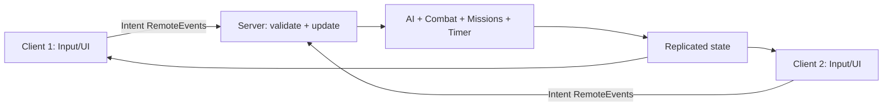

# Roblox technical architecture (planned)

> **Current design / implementation boundary:** [GDD.md](GDD.md) describes the selected five-day, 1–4-player survival direction. The architecture and implementation descriptions below primarily document the older A01 prototype. They are historical or existing-code descriptions, not evidence that the new survival systems, persistence or four-player play are implemented. New work must remain server-authoritative and follow [SURV acceptance criteria](ACCEPTANCE.md). CR-014 and instructor/team review track the design transition.

## Data ownership
- **Workspace:** camera-visible map, NPC instances, physics crates/plates and triggers.
- **ReplicatedStorage:** shared constants and minimal RemoteEvents/state snapshots.
- **ServerScriptService:** authoritative AI, combat, missions, round clock and validation.
- **ServerStorage:** private NPC templates, restricted assets and authoritative prefabs.
- **StarterPlayerScripts:** player input/controller/camera and local sound/VFX.
- **StarterGui:** HUD/menu/results.

## Rojo file mapping
The `default.project.json` maps `src/shared` into `ReplicatedStorage/FNABKShared`, `src/server` into `ServerScriptService/FNABKServer`, and `src/client` into `StarterPlayer/StarterPlayerScripts/FNABKClient`. Do not create two sources of truth for any path. Studio-built map models can be stored as `.rbxm/.rbxmx` files under `assets/models` and reviewed as authored assets; avoid editing the same synced script in Studio and filesystem.

## Trust boundary

Never accept arbitrary damage/HP/Keys from clients. Validate target types, line of sight, maximum range, server cooldown, player alive and state. Use server timestamps for shared clock. Expose a deterministic state reset routine for tests. Systems beyond the current prototype slices are still planned work and are not yet gameplay implementation.

## Current prototype slice

The source currently builds a runtime graybox, one server-owned Mimic FSM, and AC-04 baton / AC-05 UV and Scanner prototype slices. AC-06 adds a physical A3 FuseCrate and a thin, non-collidable PressurePlate flush with the floor. CR-001 adds a server-validated E prompt to carry the crate in front of the character using a WeldConstraint; collision remains enabled while carried and player movement slows. The carried offset leaves space between the crate and character so dropping it restores normal movement immediately. The crate remains dynamic and collidable on drop. Body-push movement slows only when the player actively moves into the dropped crate and restores as soon as that input stops or contact ends. The service temporarily assigns physics ownership to the carrier or active body-pusher for responsiveness and monitors speed and in-bounds position changes. Only the server can restore A3 power and `DataKeys/Key1`, after checking the crate is not carried, its full footprint fits, and it has settled. A bounds monitor returns an inaccessible crate to its start position after the A01 10-second recovery interval. AC-07 adds three Library suspects, shared interview evidence, two server-authored Mimic clues and a correct-accusation check before the server grants `DataKeys/Key2`. AC-08's B4 slice requires Key 2, records the shared fuse pickup, and grants `DataKeys/Key3` only after the server validates the generator interaction. `RoundService` owns the shared 900-second countdown, Gate 1's all-keys prerequisite, a server-timed five-second hold with range/LOS rechecks, timeout/team-down loss, and victory after a living player crosses into the exit volume. `PlayerLifeService` routes Mimic damage, marks incapacitated/eliminated players on the server, gives a co-op teammate 20 seconds to revive with a five-second hold within six studs, and restores the target to 40 HP. Interaction services and Mimic targeting reject downed/eliminated players. The client renders replicated time, key count, objectives and life-state feedback. The user reported a successful Gate escape and a passing revive retest; timeout/team-down remain untested. Medkit is implemented with Studio validation pending, so this is not a complete round.

The Mimic uses `Humanoid:TakeDamage()` from the server after checking its visible target and attack cooldown. Baton, UV and Scanner intent travel through `FNABKRemotes`; the server validates the server-granted Tool, living player, known NPC, range, line of sight and per-player cooldown before changing Mimic health, Trust, Alert, Student state, the Mimic's timed `Stunned` state, or returning a Scanner classification. Scanner results require the server to maintain valid range and line of sight for the configured one-second scan. The client chooses an aimed NPC and renders feedback; it does not set damage, stun duration, NPC state, or scan classification. Trust, Alert, A3 power and Data Key values are replicated read-only state for the current prototype. Other round systems remain planned work, so these slices are not a complete round or MVP.

The client also has a Studio-only range guide. It reads Baton, UV and Scanner ranges from `GameConfig`, displays the selected radius with a local `SphereHandleAdornment`, and reports distance from the player `HumanoidRootPart` to the aimed NPC `PrimaryPart`. The guide is enabled only when `RunService:IsStudio()` is true; it sends no remotes and does not change server validation. The Scanner preview now matches the server's 12-stud gameplay range.

## Build boundary

`A3Graybox` adds a small primitive-based A3 lab sample, workbenches and destination board at runtime. It keeps the crate and mission objects in their established paths; most decoration cannot be touched, collided with or queried, except the two short solid back-corner wall returns and furniture intended to block movement. The A3 facade door is 16 studs wide because the Mimic pathfinding agent has a 2-stud radius; the previous 10-stud opening was walkable by a player but returned `NoPath` for that agent. Fresh radius-2 route probes now reach the A3 interior. Natural Mimic pursuit and visual acceptance remain pending.

`CampusEnvironment` and `CampusExpansion` build the runtime 300 x 300 stud A01 campus schematic. A3, Library and B4 offsets are centralized in `CampusLayout`, with Gate 1 at the east entrance. Three source-built mission shells keep their objective openings, classroom windows, story bands, canopies and roof edges. The South Academic Wing and North Academic Hall use the single-MeshPart White Building 2 asset (Creator Store 7932859944, Karcist); the West Academic Complex uses the 1,961-part School asset (Creator Store 10403432220, LovesCake_09) when its script-free local ServerStorage import is present. Source-owned fallbacks cover missing imports. The Library has a raised reading hall and portico columns, A3 has lab benches and ventilation grilles, and B4 has generator equipment, vents and exhaust stacks. The optional residential-looking annex is not part of the runtime map. The source-built Campus Quad fountain has collidable masonry; water and plaque are non-collidable. Structural walls, floors, roofs, all three Marketplace school models, benches, lamp poles, planter stone edges, wayfinding boards/posts and fountain masonry collide. Front window glass blocks bodies but is excluded from sight-ray queries; decorative side glass overlays solid walls. Ten Oak trees (asset 8556375773) are about 2.64–2.78 studs tall with 3.2 x 0.7 x 0.7-stud collidable trunk proxies; leaf meshes, water, plaque, facade trim, planter soil, shrubs, flowers, path markings, grass and backdrop remain decorative and passable. Marketplace geometry is cloned only after checking for BaseScripts; imported scripts and UI are never copied. `TraversalGuard.client.luau` disables the default Humanoid Climbing state because the GDD has no climbing mechanic and controlled tests showed avatars scaling glass panes. `CampusBackdrop` adds non-collidable silhouettes outside the playable boundary. Night ambient remains brighter while the clock stays at midnight. These changes support AC-01/02/03/06/07/08/09 without changing A01 mission anchors; natural traversal, human style approval and target-device performance remain in `docs/MANUAL_CONFIRMATION.md`.

Current Studio verification on 2026-10-31: the generated map contains 3,255 BaseParts (2,219 collidable) and zero BaseScripts under the map. The spawn pad is invisible and non-collidable. Radius-2 PathfindingService now reports `Success` for Gate→A3 interior→Library→B4→Gate after widening the A3 entrance from 10 to 16 studs. Asset inspection found two enabled scripts in each approved classroom-pack import; these scripts were not run and those models are excluded. See `docs/ACCEPTANCE.md` for run details and `docs/MANUAL_CONFIRMATION.md` for the remaining human review.

`MovementService` owns stamina and calculates speed from sprint/crouch intent, life state and server-set crate-carry/push attributes. Crate interaction sets its restrictions rather than restoring a previously captured speed, so the current requested mode determines speed when a restriction ends. Sprint drains only while horizontal motion is detected; exhaustion requires releasing Shift. The client displays replicated stamina and renders a crouch pose for players. The Mimic samples grounded server-observed motion at provisional stance-dependent distances; heard movement leads to investigation without bypassing sight checks for attacks. Pose quality and hearing balance need human validation.

Historical Oak tree and lighting refresh (superseded by the small-tree follow-up in CAMPUS_ASSETS.md): Studio Play generated 1,610 BaseParts (340 collidable), 20 source-rebuilt Oak trees, and successful radius-2 paths from Gate spawn through A3, Library and B4 back to Gate. Output had no new map startup error; the existing audio asset type warning remained. Ground-level and overview captures confirmed geometry renders, while natural traversal, co-op, target-device performance and human style approval remain pending in `docs/MANUAL_CONFIRMATION.md`.

`ObjectiveHintService` monitors shared server-owned mission values and resets an inactivity timer when progress changes. After 90 seconds it broadcasts one phase-specific hint; terminal rounds produce no hints. Clients only display the message. Human co-op/readability confirmation is tracked in `MANUAL_CONFIRMATION.md`.

`MedkitService` creates two graybox pickups and owns each player's carried state. It checks a living player, round status, six-stud range and line of sight before pickup. The client sends only R-key intent; the server consumes the held item and caps healing at maximum health. The replicated player attribute is used for the inventory display. Studio validation is pending.
`rojo build default.project.json -o build/FNABK.rbxlx` produces an initial place with synchronized scripts. Launch Studio and connect Rojo plugin with `rojo serve`; actual interactive physics/AI/network tests must run in Studio. The repository is **not** a replacement for shared Roblox Studio access: each developer needs appropriate permissions on the Roblox experience/place.

## AI agent boundary
Codex CLI may inspect local files by default. Studio interactions additionally require **official Roblox Studio MCP Quick Connect** locally; configuring GitHub or Rojo alone does not grant it access to an open Studio session. Require explicit approval for scene mutations, playtests and destructive operations.
Automated Studio MCP checks on 2026-10-31: the current map contained 844 BaseParts (402 collidable) and 20 trees. At scale 0.14, the two source meshes give a calculated tree height of about 2.79 studs; each tree has a 3 x 1-stud trunk collision proxy. The Marketplace school clone measured 33.12 x 33.90 x 23.85 studs, had 142 BaseParts and no scripts. Radius-2 pathfinding returned `Success` on Gate→A3, A3→Library, Library→B4 and B4→Gate. Direct server-side `Humanoid:MoveTo` stopped at the north academic window and a collidable school part; after navigating beside a tree, the character moved 2.49 studs and stopped at the tree proxy. These are single-client automated checks, not natural-speed route completion or a multiplayer result. The Studio capture showed the HUD over a black 3D view, so map visual quality could not be confirmed. See `docs/MANUAL_CONFIRMATION.md` for the human confirmation queue.
