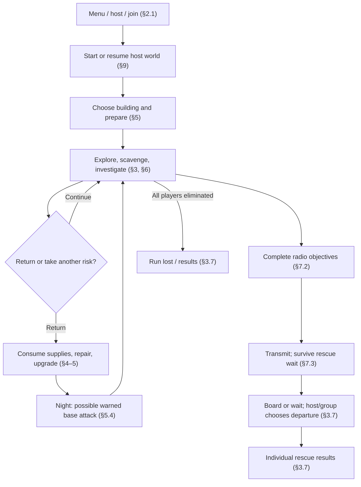
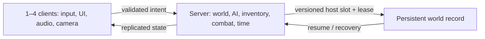
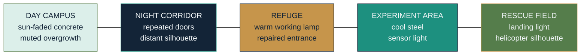

# Five Nights at Bách Khoa (FNABK)

**Current consolidated game design document — survival revision 1.1, 2026-11-03**

**Status and authority.** This is the current project GDD for the survival direction, selected by the user. **Selected** means explicitly chosen in the design discussion, including the five-day structure; **prototype proposal** means a concrete default added so the game can be designed and tested. Other numbers, balance and wave schedules are proposals, not measurements. This document is self-contained for review. It does not change the existing implementation or claim student-team, instructor or course approval. The previous A01 GDD is preserved as [old version](archive/A01_GDD.md); CR-014 records the design change. The student team must review scope and any course requirements before submission.

**Course:** Game Programming (CO3045), class CC02, Group 07. **Instructor:** Phan Trần Minh Khuê. **Team:** Vũ Hải Tuấn (2353280), Chu Nguyễn Tuấn Anh (2352022), Lê Hoàng Chí Vĩ (2353336).

## 1. Concept and vision

| Field | Design |
|---|---|
| Title | Five Nights at Bách Khoa (FNABK) |
| Submission language | English |
| High concept | After a technical failure makes a university disaster-response and evacuation simulation develop beyond expectations, creating hostile Mimics and isolating the campus, 1–4 students choose a campus building as their base, survive day/night expeditions, identify impostors, and signal a rescue group organized by survivors outside the quarantine zone. |
| Genre and elements | Third-person 3D survival horror, exploration, stealth, investigation, melee and limited-ammunition firearms, light crafting and cooperative rescue. |
| Audience | Players who enjoy moderate horror, cooperative survival and environmental mysteries; playable without knowing the actual campus. PC keyboard/mouse; target age classification to be determined. |
| Platform and technology | Roblox on PC, 3D low-poly geometry, third-person camera, Luau; solo or online co-op for 2–4. No local split-screen. |
| Play time | Selected direction: five in-game days, with a target of approximately 1–2 real hours per completed run and host-owned saving between sessions. Not a measured result. |
| Unique appeal | Familiar university buildings are both explorable spaces and player-chosen bases; a teammate's appearance can be copied by a Mimic, while experiments create distinct creatures and machines. |
| Design constraints | Moderate, readable horror; solo completion; no real-world map-accuracy claim; low-poly performance target on Intel Iris Xe, not a measured result. |

**Experience pillars:** Make purposeful trips; weigh supplies against danger; verify rather than guess; transform a chosen campus building into a defensible base; tell the experiment's story through spaces and discoveries. Avoid gore, obligatory voice chat, mandatory multiplayer, opaque unavoidable deaths and secret-only progress gates.

**Reference analysis.** *Five Nights at Freddy's* informs anticipation and limited information; avoid relying on repeated jumpscares. *Phasmophobia* inspires cooperative observation and evidence; this game centers an explorable campus and survivor resources rather than ghost identification alone. *Don't Starve* inspires planning around day/night and supplies; use gentler needs and a finite rescue objective rather than copying its survival pressure. These are design comparisons, not asset sources. The provided [Game Dev Beginner guide](https://gamedevbeginner.com/how-to-write-a-game-design-document-with-examples/), [GitBook guide](https://www.gitbook.com/blog/how-to-write-a-game-design-document) and [beginner template](https://github.com/kosinaz/game-design-document-template-for-beginners/blob/master/docs/Game%20Design%20Document.md) informed the document's structure.

## 2. Gameplay experience and flow

A player enters a saved campus with friends or starts alone. During daylight the group chooses B1 as its first base, repairs lights and packs water. Two players travel to A3 while another searches the library; a figure resembling the fourth teammate appears, but a visible anomaly and a UV response reveal a Mimic. They return with a radio part. At night a warning precedes an attack on the barricaded entrance. After several days and a sequence of repair tasks, they send a distress call, reach the sports field and decide how long to wait for the last teammate before leaving.



### 2.1 Game application flow

Main Menu → Host / Join → New Run or Load Host Save → Lobby (1–4) → Briefing → Campus → Rescue / Defeat Results → Menu. Settings are available from menu and pause overlay; multiplayer continues while a player views menus. Host resume, invitations and slot access use Roblox-supported multiplayer facilities; no third-party backend is assumed. Leaving or closing before a successful save must not be reported as saved.

### 2.2 What makes play enjoyable

Players repeatedly make understandable tradeoffs: gather food or investigate a signal; move quietly or arrive sooner; risk a suspicious person or spend time verifying them; defend an established base or transport supplies to a better-located one. Finding an optional hidden room changes resources or understanding, never whether rescue is possible.

## 3. Player, controls and rules

### 3.1 Player definition and feedback

Each student has health, stamina, food, water, a carried inventory and limited respawns. HUD changes immediately show damage, low stamina, hunger, thirst, available interact actions and critical objective states. Positive pickups include food, water, medical items, parts and information (§4.3). No player class is required; a solo player has access to every mandatory ability.

### 3.2 Controls — prototype proposal, PC

| Input | Action | Constraint / feedback |
|---|---|---|
| WASD / mouse | Move / aim camera | Third-person, clear reticle |
| Shift / C | Sprint / toggle crouch | Stamina / quieter movement |
| E | Interact, pick up, hold to revive | Prompt, hold progress, validated range |
| Left mouse | Attack with equipped melee weapon or fire an equipped gun; hold for automatic rifle fire | Server-validated cooldown, ammunition and hit/miss feedback |
| F / Q | UV stun / identity scan | Tool equipped, charge/cooldown feedback |
| 1–4 / Tab | Select carried tool / inventory and objectives | No network pause |
| R / Esc | Use medkit / menu | Reject unavailable item; settings accessible |

These keys are a design proposal, subject to remapping feasibility and testing. The firearm reload key is not yet selected; it must not conflict with the proposed medkit control. Text, icons and sound must not rely on color alone.

### 3.3 Player state and co-op recovery

**Selected:** Each player has **100 maximum HP** and **three respawns per run**, consumed on respawn, at the active base when playing solo. In co-op a downed player has **30 seconds** for a teammate to revive them by holding E for **5 seconds**; a successful revive restores **40 HP**. The hold must finish within the 30-second window; if the rescuer is attacked or leaves interaction range, it is interrupted and must restart from zero. A successful teammate revive retains the player’s food and water values; if either remains at zero, the selected starvation/dehydration damage continues at 1 HP per 5 seconds total. If the window expires and a respawn remains, they automatically respawn immediately at the active base with **100 HP**, food **50** and water **50** regardless of their previous values, and consume one respawn. A player who respawns is immune to damage for **5 seconds or until they attack**, whichever occurs first. A co-op player with no respawns left still has the 30-second revive window; if it expires without a revive, they become a spectator. If all players are downed but at least one has a respawn remaining, wait for the applicable automatic respawn instead of ending the run. When all players are downed or eliminated and no one has a respawn remaining, the group loses; playing again starts a new run. At 0 health, friendly-fire damage can down a teammate just like other damage.

**Prototype proposal:** At 0 HP the player is Downed and cannot attack. The 5-second revive interaction is available within a proposed 6-stud distance during the selected 30-second window. In solo, reaching 0 health skips the teammate-revive wait and offers a respawn if one remains. If no base is active, a protected initial spawn is the temporary respawn point. After the revive window expires with zero remaining respawns, an eliminated player spectates while teammates can still continue. The interaction range, initial fallback and treatment of disconnected players during a group wipe require review and testing.

**Selected:** On respawn the player's carried items drop as a recoverable bag at the location where they were downed. The bag owner and teammates can take items from it.

**Prototype proposal:** The bag remains for the rest of the run and the server tracks one unique location for each item; concurrent retrieval requests must not duplicate items. A bag inaccessible for 60 s or outside playable bounds returns to the active base storage, or to the initial spawn if no base exists. These bag recovery rules need testing, including teammate access, disconnects and full storage.

### 3.4 Actions and interaction

Move, sprint, crouch, inspect, scan, interact, carry and transfer items, attack with melee weapons, fire and reload limited-ammunition guns, use UV, repair, craft, claim a base and board the helicopter. Interactions require an alive player, server-validated distance of at most 6 studs and line of sight when applicable. A physical fuse crate can be pushed or carried and placed on a pressure plate; position and settled state matter. Keep this physics task as a proposed A01-compatible interaction unless formal review changes it.

### 3.5 Combat and mistaken identity

**Selected:** A validated baton hit or firearm shot against a teammate causes **5 HP** of damage and can down that teammate if their health reaches 0. For a shotgun, the selected unit is one shot, not each individual pellet; a single shotgun shot cannot apply multiple 5-HP friendly hits to the same teammate. **Prototype proposal:** use the same weapon cooldown for teammate hits. Show clear friendly-hit feedback without exposing a Mimic's identity before a hit. The server validates attacker state, possession, range, line of sight and cooldown; a client never supplies damage. Friendly-fire rules apply to validated hits; the server does not infer the attacker's intent.

**Selected:** Players begin with a melee weapon and find a **pistol, shotgun, rifle and limited ammunition** in the school. Each firearm uses its own matching ammunition-box type. A full pistol, shotgun or rifle box holds **20, 10 or 30 rounds** respectively; each firearm holds at most **12, 6 or 30 loaded rounds** respectively. An inventory slot holds up to five boxes of the same type. A partially used box retains its remaining rounds for later use; loading a weapon must not discard unused ammunition. The shotgun reloads one shell at a time, and the player can interrupt reloading to fire with shells already loaded.

Selected base damage against enemies per shot is **25 HP for the pistol, up to 60 HP for the shotgun when all pellets hit at close range, and 35 HP for the rifle**. Each shotgun shot fires **6 pellets**, each dealing up to **10 HP** to an enemy; if all six hit, damage is 60 HP through 15 studs, decreases linearly to 30 HP at 40 studs and continues linearly to **0 HP at 65 studs**. A shotgun pellet causes no damage beyond 65 studs. The number of pellets that actually hit determines partial-hit damage; these enemy-damage rules do not override the selected 5 HP maximum per shotgun shot against an individual teammate (§3.5). The rifle fires automatically while the player holds the fire input. The pistol and shotgun fire one shot per press; holding the input does not repeatedly fire them.

**Selected gunshot noise:** A gunshot attracts enemies within **60 studs for the pistol, 100 for the shotgun and 120 for the rifle**. Walls do not reduce these hearing distances. The server emits and validates the noise event; one shotgun shot is one noise event rather than one per pellet. **Prototype proposal:** measure the straight-line distance from the shot origin to the enemy. How different enemy types prioritize the sound over a current target remains undecided. Attraction does not create a scheduled base-attack wave or allow attacks on base defenses during the day; the separate selected rule keeps base attacks at night.

Selected minimum intervals between shots are **0.4, 1.2 and 0.15 seconds** respectively. Selected reload times are **2 seconds for the pistol, 0.7 seconds per shotgun shell, and 2.8 seconds for the rifle**. Track rounds per box even when boxes of the same type are stacked, and track loaded ammunition in each weapon so transfers, dropped bags and saves do not duplicate or lose rounds. The selected timing and damage require playtesting against the chosen hordes. The server must validate weapon ownership, matching ammunition, loaded capacity, fire rate, target and hit path, and consume ammunition authoritatively; a client cannot choose damage or confirm its own hit. A reload interruption must not simultaneously duplicate a shell and fire it.

### 3.6 Rewards and pickups

| Pickup | Prototype effect | Use / risk |
|---|---|---|
| Food portion | Selected: +35 food, capped at 100 | Consumed from inventory |
| Water bottle | Selected: +40 water, capped at 100 | Proposed: refill at enabled safe source |
| Medkit | Selected: +40 HP, capped at 100 | Proposed: cannot revive from inventory remotely |
| Ammunition box | Selected: pistol 20, shotgun 10 or rifle 30 rounds per full box | Each gun uses its matching box type. Find in the school; stack at most five boxes of the same type per slot. A partly used box retains remaining rounds. Supply remains open. |
| Scrap / electronics / cloth | Crafting and repairs | Occupy slots; transport when moving |
| Radio component / fuse | Advances shared rescue objective | Server-owned objective progress; lost world item is recoverable |
| Log / map clue | Lore and optional secret hint | Read without consuming essential resources |

### 3.7 Win, loss and partial rescue

Selected: restore power, find the radio frequency and transmitter components, and send a distress signal at any time once those prerequisites are complete; after both the signal and the fifth night, the rescue helicopter arrives at a campus sports field in approximately 4 minutes. If the signal has not been sent by the end of night 5, the group has **10 real minutes** after night 5 to send it; the run is lost if that deadline expires without a signal. Up to three base attack waves start at **1, 4 and 7 minutes** after night 5 during this grace period. Each has **24 total attackers solo: 20 creatures, 3 machines and 1 Mimic**, scaling to 36, 48 or 60 total attackers for 2, 3 or 4 eligible players under the existing party-scaling rule. Co-op composition keeps approximately the solo proportions, rounded to match the total. **Selected co-op composition:** 30/5/1, 40/6/2 and 50/8/2 creatures/machines/Mimics for 2, 3 and 4 players. Each grace-period wave has an audible warning and a text notification **30 seconds before its start**. If the signal is sent after that warning but before the wave starts, cancel the wave and notify players that it was canceled. Remaining attackers from the three grace-period waves begin retreating at **3:30, 6:30 and 9:30** after night 5 respectively; the first two retreats begin 30 seconds before the next wave, and the last begins 30 seconds before the signal deadline. Before the next wave spawns, they must leave; a stuck attacker is removed outside player view when possible; if still visible at the scheduled start, it disappears with a visual effect before the new wave starts on time. Sending the signal stops scheduling new grace-period waves; an active wave continues during the helicopter wait with its originally scheduled retreat, and attackers already retreating continue their retreat. If the signal was sent before night 5 ends, no new base wave starts during the helicopter wait, but enemies already active remain dangerous. Grace-wave spawn pacing and retreat completion remain subject to review. The helicopter waits up to **3 minutes**, then departs automatically; show the boarding countdown to all connected players. It can depart earlier when a strict majority of players currently aboard agrees. Each player aboard at departure is rescued; the group may wait for others until departure or timeout. A downed player cannot be carried aboard and must be revived before boarding. Players aboard the landed helicopter are immune to all damage, including hunger and thirst damage; they may leave the helicopter before departure. If a player is nevertheless downed while already aboard, they are rescued if still aboard at departure; a player downed outside at departure is Left Behind, not rescued.

**Selected:** Before a departure vote starts, show the initiating boarded player a warning listing all group members not aboard, including downed, eliminated and disconnected statuses. Update the list if the boarding roster changes while the warning is open; if the initiator leaves the helicopter, close the warning and require them to board again before initiating. The vote starts only after they proceed. The helicopter still departs immediately at the three-minute deadline if the warning is open. Any boarded player can initiate a departure vote and automatically casts one yes vote. Players aboard may change or withdraw their votes until departure or the vote ends. It lasts at most 10 seconds; any change to the boarded roster cancels it, and a new vote can be initiated. If a boarded player disconnects before departure, remove them from the boarded and voting rosters and cancel any ongoing vote; on reconnect before departure they appear at the active base under the normal living non-host reconnect rule. The helicopter departs immediately when a strict majority agrees; if only one player is aboard, initiating the vote immediately causes departure because their automatic yes is a majority. If the vote expires without a strict majority, it continues waiting for another vote; the helicopter departs immediately at the three-minute boarding limit even if a vote is underway. **Prototype proposal:** Use an onboard control to initiate the vote. The remaining vote-control details require review. A connected, non-eliminated player aboard at departure receives **Rescued**; a connected, non-eliminated player not aboard, including one who is downed outside, receives **Left Behind**. Solo boarding and departure yields **Rescued**. The group sees both individual results and whether anyone escaped. **Selected:** A player disconnected at departure receives **Disconnected**, and a connected eliminated spectator receives **Eliminated**; neither is credited as rescued. The detailed vote interaction remains proposed.

The helicopter protects boarded players from all damage but does not teleport unboarded players. A player can unboard before departure. **Selected:** if everyone is downed or eliminated and no one has a respawn left before departure, the group loses and must start a new run to play again. **Selected:** A helicopter departure with no boarded player ends the run in group defeat. A host leaving during this sequence and final-save recovery need playtesting.

## 4. Game systems and provisional balance

Values below are **prototype proposals for a 1–2-hour run unless explicitly marked Selected**, not playtest results. Server time is authoritative and all rates are per real second unless stated.

### 4.1 Baseline values

| Property | Start / cap | Proposal | Feedback |
|---|---:|---|---|
| Player HP | Selected: 100 / 100 | Enemy and deprivation damage; selected medkit +40 HP | HP bar, directional hit indication |
| Stamina | 100 / 100 | Sprint −22/s while moving; regen +18/s after 1 s | Stamina bar; sprint stops at 0 |
| Food | Selected: 100 / 100 | Selected: −1 per real minute while alive | Icon and numerical status at low level |
| Water | Selected: 100 / 100 | Selected: −1.5 per real minute while alive | Distinct low-water warning |
| Shared Trust | Selected: initial 100, range 0–100 | Selected: −10 per validated hit or shot against an innocent NPC; +10 for each valid act of helping an NPC or completed side quest | Shared value and NPC response |
| Movement | — | Walk 12, sprint 19, crouch 7 studs/s | Animation and movement noise |
| Melee / firearms | — | Selected enemy damage: pistol 25, shotgun up to 60 for a full close-range hit, rifle 35 HP/shot. Selected friendly fire: baton hit or firearm shot deals 5 HP and can down; shotgun pellets count once per shot per teammate. Proposed: baton deals 25 damage to enemies, 4.5-stud range, 0.85 s cooldown. | Distinct hit and miss |
| Loaded gun capacity | Selected: pistol 12 / shotgun 6 / rifle 30 rounds | Each uses its own matching ammunition-box type; unused rounds remain in the box | Loaded count and matching-box availability |
| Fire interval | Selected: pistol 0.4 s / shotgun 1.2 s / rifle 0.15 s between shots | Server rejects firing faster than the selected interval | Fire and cooldown feedback |
| Reload duration | Selected: pistol 2 s / shotgun 0.7 s per shell / rifle 2.8 s | Shotgun reload can be interrupted to fire loaded shells | Reload progress and loaded count |
| Gunshot hearing radius | Selected: pistol 60 / shotgun 100 / rifle 120 studs | Walls do not reduce the radius; enemies within it are attracted | Shot audio and observable investigation |
| UV | — | 13-stud range; stun 2.2 s; cooldown 14 s | Beam and timed cooldown |
| Scan | — | 12 studs, line of sight, 1 s scan, 8 s cooldown | Suspected / no anomaly found |
| Carry | Selected: 8 slots | Selected: one stack of up to 5 items of the same type per slot, including up to 5 ammunition boxes of the same type; proposed: completed objective progress does not consume slots | Slot count; reject full inventory |
| Revive / respawn | Selected: 3 respawns/player | Selected: 30 s downed window, 5 s hold and 40 HP after revive; automatic respawn with 100 HP; proposed: 6-stud interaction range | Countdown, prompt, remaining uses |

`food_next = clamp(food - elapsed_minutes, 0, 100)`; `water_next = clamp(water - 1.5 × elapsed_minutes, 0, 100)`. **Selected:** If either food or water reaches 0, health decreases by **1 HP every 5 seconds total**, including when both meters are empty. Damage stops once both are above 0 and is prevented while aboard the landed helicopter. No damage accrues while eliminated or in an unloaded saved world. Food and water do not decrease while a non-host player is disconnected; zero-need damage is also paused while disconnected and resumes on reconnect if either need is still zero. Starting with 100 of each, after 60 minutes without consuming items a living player has 40 food and 10 water. The selected rates and damage must still be playtested.

`stamina_next = clamp(stamina - 22 × sprint_seconds + 18 × eligible_regen_seconds, 0, 100)`; regen starts after 1 s without sprinting. For one validated Trust change, `Trust_next = clamp(Trust + change, 0, 100)`, where a qualifying innocent-NPC hit or shot is −10 and a valid act of helping or completed side quest is +10. The server must validate the qualifying action and apply each completion event once, preventing repeated requests from duplicating a reward. Enemy damage is `HP_next = max(0, HP - validated_damage)`. For a shotgun hit at distance `d` studs, each hitting pellet deals `10` HP when `d ≤ 15`, `10 × (1 - (d - 15) / 50)` HP when `15 < d < 65`, and `0` HP when `d ≥ 65`. Thus all six pellets deal 60 HP at 15 studs, 30 HP at 40 studs and 0 HP at 65 studs. For a valid baton hit or firearm shot against a living teammate, `HP_next = max(0, HP - 5)`; reaching 0 triggers the downed/recovery flow. A shotgun shot applies that friendly-fire calculation at most once per teammate regardless of pellet count. Attacks on already downed teammates are rejected in the prototype proposal.

A single validated shot that hits multiple innocent NPCs still causes only one −10 Trust penalty; multiple pellets are not separate shots. The server must deduplicate attack events as well as completion events.

### 4.2 Time, pacing and difficulty

**Selected direction:** The run spans five in-game days, titled Five Nights at Bách Khoa (FNABK); the helicopter arrives after the fifth night. Each day lasts **12 real minutes**. Base attacks occur at night and continue during the post-night-5 signal grace period, grow more dangerous and give advance warning. The selected wave counts for nights 1–5 are **0, 2, 2, 3 and 4**, totaling 11 nighttime waves, with up to three additional waves if the signal is delayed after night 5; the five nights last **5, 5, 5, 6 and 8 real minutes** respectively. Exact enemy composition, pacing and wave duration still require design and playtesting.

**Timing model:** Five 12-minute days add 60 minutes and the selected nights add 29, totaling 89 real minutes. Once both the signal and night 5 are complete, the selected approximate 4-minute rescue wait brings the earliest arrival to about 93 minutes if prerequisites were met in time. The selected boarding window of up to 3 minutes gives up to about 96 minutes in this example; a signal after night 5 can extend the run by up to 10 minutes before the rescue wait and boarding window. This illustrates the 1–2-hour target, not a measured duration.

**Wave design:** A wave is one warned group of attackers; there can be more than one wave in an attack night.

| Night | Selected waves | Selected duration | Enemies per wave, solo | Design purpose |
|---|---:|---:|---:|---|
| 1 | 0 | 5 min | — | Learn the base, resources and routes |
| 2 | 2 | 5 min | 10 | Learn warning cues, defense and repairs |
| 3 | 2 | 5 min | 14 | Add pressure while players explore and prepare |
| 4 | 3 | 6 min | 18 | Escalate threats and coordination |
| 5 | 4 | 8 min | 24 | Final defense before rescue |

Total: **11 waves across four attack nights**, with the first night quiet. The selected solo counts are **10, 14, 18 and 24 total attackers per wave** on nights 2–5: 20 + 28 + 54 + 96 = **198 spawned attackers** if every scheduled solo wave completes. The user wants waves to feel densely populated and exciting, comparable to a zombie horde rather than a handful of isolated enemies. This is the total per wave, not a claim that all appear or remain alive simultaneously, or that every one must be defeated.

**Selected party scaling:** each additional player adds 50% of the solo count, rounded up: `wave_total = ceil(solo_total × (1 + 0.5 × (players - 1)))` for 1–4 players. At the start of each wave, record the number of connected players who are alive or downed, and use it for that wave's total and active-enemy cap. A player who has exhausted respawns and is spectating is not counted. Players joining or leaving during the wave affect scaling from the next wave; do not recalculate the active wave. Treatment of a player temporarily waiting to respawn and a snapshot with no eligible players remain open. Waves that start solo must remain defensible without teammates; if teammates leave mid-wave, the current wave retains its initial configuration and may temporarily be harder.

**Selected wave composition:** Mutated creatures make up most attackers; experimental machines and Mimics appear occasionally. This does not require every wave to include all three types. Exact proportions, introduction timing and behavior are undecided; creatures can still use ambush behavior outside base attacks.

| Night | Wave count | Total per wave: 1 player | 2 players | 3 players | 4 players |
|---|---:|---:|---:|---:|---:|
| 1 | 0 | — | — | — | — |
| 2 | 2 | 10 | 15 | 20 | 25 |
| 3 | 2 | 14 | 21 | 28 | 35 |
| 4 | 3 | 18 | 27 | 36 | 45 |
| 5 | 4 | 24 | 36 | 48 | 60 |

If party size remains fixed and every scheduled wave spawns its full total, five-night totals are **198 / 297 / 396 / 495** for 1 / 2 / 3 / 4 players. These are planned total spawns, not measured difficulty.

**Selected simultaneous wave caps:** at most **20 / 30 / 40 / 50 active enemies belonging to a wave** for 1 / 2 / 3 / 4 players respectively, using the party-size snapshot at the start of that wave. The actual count cannot exceed the wave's total, so a solo 10-enemy wave can have at most 10 of its attackers active, not 20. These caps apply to wave attackers, not necessarily to enemies encountered elsewhere in the campus. Grace-period waves do not overlap: remaining attackers from the preceding wave must leave before the next spawns. Active counting for other overlapping waves remains to be specified; retreating enemies count until they leave.

**Selected scheduling rule:** Keep the selected night durations. If the active-wave cap prevents remaining attackers from appearing, earlier groups retreat on a schedule to free capacity for the rest of the wave; do not extend the night or drop the remaining scheduled spawns merely because the cap was reached. Schedule the withdrawal early enough to fit all wave spawns within the night, while keeping the cap, advance warnings and player feedback. Count enemies as active until they have actually completed their retreat or been removed; an enemy beginning to retreat does not instantly free a slot. Exact spawn pacing, retreat duration, behavior for stuck enemies, enemy composition, wave duration and recovery intervals remain open and must be designed together. Validate the schedule with slow kills, maximum selected wave totals, fixed party sizes and target hardware in solo and 2–4-player playtests.

### 4.3 Resources, crafting and economy

There is no currency, real-money economy or trading with unknown players in this design. Materials are found on expeditions and placed in per-building storage; taking resources from a previous base requires physically carrying them. No essential key component is consumed by death. A full storage container refuses a transfer and leaves the item at its source. When a player has no inventory capacity for a pickup, the item stays in place and the player receives an inventory-full message.

| Recipe / upgrade | Prototype cost | Effect |
|---|---|---|
| Defensive repair | 2 scrap | Restore one damaged barricade by 50 HP, up to its maximum |
| Bandage | 1 cloth | Restore 15 HP; 3 s use |
| Restore a building's local power | 2 electronics + 2 scrap | Lights and existing power-dependent upgrade points function |
| Organize storage | 2 scrap | Add 8 slots at that building, once |
| Reinforce one suitable entrance | 3 scrap + 1 cloth | Install 100-HP repairable barrier; no essential exit is sealed |
| Radio repair | Objective components; no consumable | Enables signal after timing requirement |

Players begin with a melee weapon and find firearms and ammunition within the school. **Selected supply direction:** Food, water and ammunition are replenished in limited quantities by in-game day, and total supplies increase with party size while encouraging sharing. Beginning at the start of day 2, replenishment occurs at the start of each new in-game day at suitable locations that vary by day; day 1 uses initially placed supplies. These supply points are not marked on the map and players discover them. Uncollected supplies remain, and each location has a shared cap of **10 items** across all item types; one food portion, water bottle or ammunition box counts as one item. Replenished supplies are shared: any player can pick up and share them. For simultaneous pickup requests, the server grants the item to only one player and tells the other it has already been taken. If selected points lack capacity, prioritize water, then food, then ammunition; when ammunition does not all fit, alternate among its three types. Starting on day 2, rotate the starting ammunition type on successive replenishment days: pistol → shotgun → rifle, then repeat; skip a type once its daily allocation has been filled and continue with types still owed. Discard that day’s unplaced replenishment rather than carry it over. Replenishment quantity uses the number of connected players at the start of the day; joining afterward does not change that day’s allocation and takes effect at the next daily replenishment. The solo daily allocation is **3 food, 4 water and 4 ammunition boxes**: 2 pistol, 1 shotgun and 1 rifle box; for each category use `ceil(solo quantity × (1 + 0.5 × (connected players - 1)))`. Allocations for 1 / 2 / 3 / 4 connected players are **3 / 5 / 6 / 8 food**, **4 / 6 / 8 / 10 water**, and **4 / 6 / 8 / 10 ammunition boxes**, subject to point capacity. The selected pistol/shotgun/rifle box allocations for 2 / 3 / 4 connected players are **3/2/1**, **4/2/2** and **5/3/2**, respectively. Selected points may include the active base, but at most `floor(0.25 × total items actually replenished that day)` items appear there, with supplies also distributed in other areas. Exact location selection and quantities require review and playtesting. **Initial resource budget proposal:** each active player starts with one food, one water and one medkit; at least four food, four water and six scrap are obtainable on accessible early routes for a solo player. Additional players receive personal starter items and +2 food/+2 water per added player distributed in shared reachable containers. Propose allocating one of the selected daily food portions and one water bottle to a suitable canteen source on a selected day if its stock is empty; the source is available without a secret and cannot be consumed by an offline player. Static placement, scarcity and 1–4-player balance must be tested; this is not proof of sufficient supply.

Objective stages require restored power, a radio frequency and transmitter components. **Selected:** each location is chosen randomly from buildings appropriate to that task, varies between runs, and is displayed precisely on the map; the three tasks can be completed in any order. Assignments remain stable when the same saved run is resumed. A3, A2 and B4 are possible illustrative locations, not fixed assignments. **Prototype proposal:** the server chooses from reviewed, reachable locations at the start of a run, records assignments in the host save, and marks the precise location and floor where relevant on the map. Any lost required physical item returns to its assigned location after 60 s; completed stages are shared and cannot be lost with a player. Candidate selection and recovery must never require an optional secret or create a blocked mandatory objective.

## 5. Bases, relocation and persistence

### 5.1 Base choice

Selected: **any campus building** may become the group's active base; each receives context-appropriate predefined power, storage and defense upgrades. One active base at a time is a prototype rule, not a restriction on returning to upgraded buildings. A player selects a building at its entrance; in co-op the host confirms after a 10 s announcement visible to everyone. The initial claim is free. Each base has a clear spawn point, a power point, storage and at least one defendable entrance plus an unobstructed exit. The 23-building coverage table is §7.5; this remains selected final scope even if early prototypes cover fewer buildings.

### 5.2 Moving and saved buildings

The group can relocate by confirming another building. Carried resources and items are physically moved by players; fixed upgrades remain at their original buildings and can be used again on return. Stored supplies remain in their original containers until moved. The new active respawn point activates only after the host confirms the new building; no item is teleported by the confirmation. Changes are server-owned and written to the host world save. A return to a damaged previous base retains its damaged state. Whether unoccupied bases are attacked is a prototype choice: **only the active base is targeted by scheduled attacks**.

### 5.3 Defenses and safety

Only marked suitable doors accept barricades; no barricade may close every way out or block required objectives. A barricade has 100 HP; a creature's prototype strike causes 20 damage every 2 s. At 0 it becomes an open damaged frame; a repair restores 50 HP for 2 scrap, preserving the route. Normal doors and building geometry are not destroyed by this prototype. Attacks affect doors and defensive equipment, not storage contents; survivors can recover without mandatory unique items being destroyed.

### 5.4 Night event

Before each wave, play distinctive distant sounds, flicker an exterior warning light where electricity exists and show a text warning; sound or color is never the only cue. Enemies approach accessible entry points. If the wave is at its selected active cap with spawns remaining, schedule earlier attackers to retreat in time to make room; the night still ends on schedule and the remaining attackers must have an opportunity to spawn. Do not count retreating enemies as having left until they actually exit or are removed. Warning times outside the grace period, spawn pacing and other withdrawal times remain unselected beyond §3.7; the previously illustrated 60-second wave is not a guarantee that the full spawn total fits. Base attacks occur at night and during the post-night-5 signal grace period; encounters away from the base can occur by day. Killing every attacker is not required to complete an objective.

## 6. Enemies, NPCs and fairness

| Threat | Selected identity / role | Prototype behavior and counterplay | Proposed balance |
|---|---|---|---|
| Mimic | Copies NPCs and player characters; moderate horror | Selected: observe unusual visual or behavioral signs and optionally verify with UV or scanner. Proposed: at least two observable clues before aggression. Can be avoided, investigated or fought. | 75 HP; 14 studs/s chase; 20 damage; 1.6 s attack cooldown |
| Listening creature | Mutated experiment; hides, listens and ambushes | Emits a rustle before attacking. Walking/crouching reduces noise; sprinting alerts within 24 studs, walking within 12, crouching within 5. | 60 HP; 16 studs/s short pursuit; 15 damage; 2 s cooldown |
| Patrol machine | Experimental machine detects light or sound | Sweeps a visible lamp cone; avoids detection by breaking line of sight or moving quietly. A disabled lamp is visually communicated. | 90 HP; 9 studs/s patrol; 18 damage; 2 s cooldown |

Values are proposals. Machine prototype: 60° forward detection cone, range 30 studs, 1 s continuous line of sight to alert; running within 16 studs also alerts. Both sensing methods have an audio and UI cue. Creature prototype: remain hidden until it hears movement; a warning sound precedes a 1 s wind-up. All enemies use server-owned finite states and bounded pathfinding; no ML is implied. A simple state cycle is Idle/Disguise → Investigate → Chase → Attack → Search → Idle; Stunned and Defeated can interrupt active states. Lose sight for 2 s → search last known position for 6 s.

Selected: players identify Mimics through unusual behavior or appearance and may additionally verify with UV or a scanner; tool use is not mandatory to notice a visual or behavioral tell. Mimics never reproduce actual chat or voice in the prototype proposal. Prototype: character-shaped nameplates are hidden beyond 8 studs, including for real players, while the party panel continues to show connected status but not precise position. A Mimic shows two clues before attacking: a repeating movement irregularity and anomalous UV reaction. At least one visual and one non-color-dependent cue are required; an accessible solo route exists. The exact presentation needs human playtesting to avoid unfair identification.

**Selected survivor behavior:** Surviving NPCs provide information, supplies and optional side quests; they do not follow the group. The entire group shares one Trust value, initially **100** and bounded from **0 to 100**. Each validated melee hit or firearm shot that hits an innocent NPC reduces shared Trust by **10**. A single shot causes only one −10 Trust penalty even if multiple pellets or multiple innocent NPCs are hit. Each valid act of helping an NPC or completed side quest restores **10**, up to the maximum; each side quest awards Trust **only once per run**, even if replayed. Repeatable helping activities grant Trust at most **once per NPC per in-game day** for the group. Depending on the NPC, help can involve delivering supplies, repairing an item or clearing an obstacle. Each in-game day, at least one NPC in the school offers a repeatable help task requiring no supplies, such as clearing an obstacle; it remains subject to the same per-NPC daily Trust limit. Qualification rules must be server-validated. An NPC may fight back in self-defense when directly attacked; low Trust alone is not the selected trigger for an unprovoked attack. A survivor NPC has **100 maximum HP**. When an innocent NPC is reduced to 0 HP they are incapacitated and automatically recover after **60 seconds with 50 HP**; they do not die permanently.

| Shared Trust | Selected NPC response |
|---|---|
| 70–100 | Normal communication and trade |
| 30–69 | Wary; offer 50% of the normal supply quantity, rounded down, with at least one item if stock is available |
| 0–29 | Stop trading and limit communication to essential exchanges |

For a normal offer quantity `S` at Trust 30–69, where `S` is no greater than available stock, offer `0` when no stock is available; otherwise offer `max(1, floor(S × 0.5))`. This limits the quantity offered rather than deleting undisplayed stock.

**Selected self-defense:** An NPC that fights back stops when the attacker has stopped attacking and stayed **more than 20 studs away continuously for 10 seconds**. If the attacker attacks again or moves within 20 studs during that period, the condition is interrupted. Behavior when an attacker disconnects or several attackers are involved remains open.

At every Trust tier, players can access information needed for rescue and may qualify for Trust recovery through helping, subject to the selected once-per-NPC-per-day limit. A particular NPC may be temporarily incapacitated or have exhausted that day's repeatable reward, so immediate Trust recovery is not guaranteed. Reduced Trust, a temporarily incapacitated NPC or an NPC's refusal must not permanently block mandatory rescue progress. The exact eligibility conditions and resources for each repeatable task, how mistaken accusations without an attack work, the number of NPCs and how encounters vary over days remain open. Existing A01 Trust behavior is not evidence that the selected survival rules are implemented.

## 7. Level, objectives and content

### 7.1 Campus sketch — conceptual, not surveyed geometry

```text
                         CAMPUS / EXTERIOR
   [A2 LIBRARY] ------- [CENTRAL ROUTES] ------- [A3 LAB]
   possible objective        |              possible objective
                            |
   [B1 CLASSROOMS] ----- [CHOSEN BASE]* ----- [B4 BUILDING]
       early supplies       |               possible objective
                            |
   [WORKSHOPS] -------- [SPORTS FIELD] ------- [CANTEEN]
    machines & tools       helicopter           food / water

   * Any campus building can be the active base. Objective assignments vary by
     run; locations and lines here are illustrative, not surveyed navigation.
```

The existing detached campus model is a candidate, not yet integrated into the runtime gameplay map. Keep existing building floor counts. Verify every route, staircase, door and landing zone in Studio; add hidden basements only after checking geometry and exits. No claimed real-world basement or surveyed layout.

### 7.2 Main mission stages

| Stage | Location | Task / teaching | Completion |
|---|---|---|---|
| 0. Establish shelter | Any chosen building | Claim base; acquire water and food; see warning system | Base active, early supplies reachable |
| 1. Restore power | Varies by run | Restore power at the assigned reachable location; a physical crate puzzle is one possible prototype | Server records restored power |
| 2. Find frequency | Varies by run | Find the radio frequency at the assigned reachable location | Server records frequency |
| 3. Find transmitter components | Varies by run | Retrieve the components needed for the transmitter | Server records components |
| 4. Signal | Radio point | Once power, frequency and transmitter components are ready, signal at any time; hold duration remains open | Distress signal accepted once |
| 5. Rescue | Campus sports field | Survive arrival wait; board before departure | Individual outcomes under §3.7 |

The locations for stages 1–3 are chosen randomly from suitable buildings and marked precisely on the map; they change between runs and the stages may be completed in any order. Specific location pools and selection rules remain design work; assignments must be reachable solo, never require an optional room, a specific base or another player, and remain stable when a saved run is resumed. Signaling becomes available immediately after restoring power and obtaining a frequency and transmitter components; the helicopter still arrives only after night 5. Hints after a proposed 5 minutes without objective progress can explain the next interaction without revealing secret rooms.

### 7.3 Example pacing

| Time / phase | Introduce / expected player decision |
|---|---|
| Day 1 | Movement, base selection, food and water; a quieter introduction |
| Day 2 | Search an assigned objective location; encounter warned waves and learn repairs |
| Day 3 / night 3 | Mimic clues, optional secret or patrol machine; face two waves |
| Day 4 / night 4 | Complete remaining stages; prepare for three waves |
| Day 5 / night 5 and aftermath | Prepare the signal and landing, survive four waves, then reach the helicopter |

This is a guide, not a requirement that the player visit buildings on a fixed day.

### 7.4 Secrets and content inventory

| Content | Planned scope | Role |
|---|---|---|
| A2 hidden archive | 1 optional room | Experiment log and supplies; never sole frequency record |
| A3 concealed basement | 1 optional area | Power-related story and extra repair materials; safe return route |
| B1 blocked classroom | 1 optional room | Survivor note and supplies |
| Enemy archetypes | Mimic, listening creature, patrol machine | Distinct threats (§6) |
| Basic items | Food, water, medkit, cloth, scrap, electronics, melee weapons, pistol, shotgun, rifle, ammunition, UV, scanner | Survival, defense and repair; ammunition quantities and enemy damage undecided |
| Objective items | Fuse, frequency record, transmitter module | Shared radio stages with recovery |
| Rescue | 1 helicopter and sports-field landing site | Individual rescue outcome |

At least two independent environmental hints lead to each optional entrance. Propose a visible difference in the room and a document clue; no secret is required for rescue. A room has an unobstructed exit, and a player can return without a second player.

### 7.5 Base coverage — all 23 buildings

These are **planned upgrade profiles**, not statements that the existing models already support them. Each row requires a power point, storage point, defendable entrance, safe spawn and tested exit; exact room/door IDs are assigned during implementation.

| Buildings | Contextual power / storage / defense profile |
|---|---|
| A1, A4, A5 | Classroom lighting / classroom cabinets / suitable corridor doors |
| A2 | Reading-hall lighting / library storage / suitable archive or hall entry |
| A3 | Lab power / equipment cabinets / lab or corridor entry; preserve puzzle route |
| B1, B2, B3 | Classroom lighting / room cabinets / selected corridor entrances |
| B4 | Technical power / parts cabinets / technical-room entry; preserve radio access |
| B6, B8, B9 | Classroom lighting / shared cabinets / selected entrances |
| B11, B12 | Academic lighting / classroom storage / selected entrances |
| C1, C2, C3 | Workshop power / tool cabinets / suitable workshop shutters and exits |
| C4, C5, C6 | Academic or practical-room power / cabinets / selected entrances |
| Facility7 | Existing service lighting / service storage / suitable entry |
| KioskOISP | Local lighting / compact storage / suitable entry |
| Canteen | Kitchen lighting / pantry storage / service entrance; food source stays accessible |

Count: A1–A5 (5), B1–B4/B6/B8/B9/B11/B12 (9), C1–C6 (6), Facility7, KioskOISP and Canteen (3) = **23**. All 23 are selected final-scope base candidates; suitability and placement are not yet verified. A prototype with one candidate is a milestone, not a replacement for the complete direction.

## 8. Narrative, world and characters

**Setup:** An HCMUT-inspired campus is isolated after a technical failure causes a behavioral-simulation experiment designed for disaster response and evacuation to develop beyond expectations and create Mimics. The student survivors search for communications equipment while evidence reveals what happened. Their distress signal is received by a rescue group organized by survivors **outside the campus quarantine zone**, which dispatches the helicopter. Experimental creatures and machines present distinct threats. The precise technical failure and the rescue group's members, resources and method of obtaining the helicopter remain to be developed. This is fictionalized and must not imply real people conducted the events.

**Story delivery:** briefing at start; environmental clues in classrooms and labs; short readable logs, visual damage and optional conversations; objective discoveries reveal enough context without requiring secret rooms. Proposed beats: discover isolation → learn the signal can work → find conflicting accounts of the simulation → restore transmission → choose who to wait for at rescue. No fixed culprit or ending explanation is approved yet.

| Character | Function | Status |
|---|---|---|
| Student player | Survivor, investigator and base planner | 1–4 players |
| Survivor NPC | Provides information, supplies and optional side quests; does not follow the group; may communicate less at low shared Trust or defend themselves when directly attacked | Selected role; no real-person likeness. Response details remain open. |
| Mimic | Impersonates NPC or player | Selected threat |
| Listening creature | Ambushes based on sound | Selected behavior, identity proposed |
| Patrol machine | Detects using light or sound | Selected behavior, model proposed |
| Rescue team | A survivor-organized group outside the quarantine zone receives the signal and sends the helicopter | Members, resources and dialogue remain open |
| Blue Professor | Optional fictional nonblocking cameo from A01 | Retain only subject to revision review; not necessary to rescue |

## 9. Save, session and networking

Selected: the host owns the saved world and reopens it for friends. When the host deliberately leaves, the server attempts to save progress and closes the session. If the host disconnects unexpectedly, wait **60 real seconds** for their return while game time and dangerous activity are paused and gameplay actions, including movement and inventory changes, are locked. Remaining players see a waiting-for-host message and the 60-second countdown. During helicopter boarding, pause the departure countdown and any still-valid vote countdown as well. If the host returns within that window, resume immediately from the paused state; otherwise attempt to save and close the session, including during boarding. If the disconnected host was aboard, remove them from the boarding roster and cancel an active vote; the helicopter countdown remains paused. The separate rule that a boarding-roster change cancels an active vote still applies. If the save fails, inform the group and resume only from the most recent successful save. Implementation of the pause and delivery of a failure notice to a disconnected host remain technical design issues. **Prototype proposal:** three host save slots; autosave at dawn, after an objective, after a confirmed base change and immediately before departure; host can request save at the active base. Save progress, game time, the rescue phase, remaining helicopter boarding time and boarding roster, the processed replenishment day and ammunition rotation, assigned objective locations, objective flags, shared Trust, which side quests already awarded Trust and which NPCs granted repeatable-help Trust that in-game day, relevant survivor state, base and all building upgrade states, per-building storage, world pickup ownership, player inventories, respawns and identity of connected participants. While the saved run is closed, its game clock and replenishment are paused; reopening resumes from the last successful save. If saved while the helicopter was waiting, restore the helicopter and its remaining boarding time. The remaining boarding countdown starts when the host enters the resumed run. Restore players recorded aboard at the save on the helicopter when they rejoin before departure; a player who has not rejoined by departure receives Disconnected, not Rescued. Do not restore an active departure vote, which can be started anew. The saved boarding roster reflects the state at the successful save, including any removals before it. If a living non-host disconnects, their character safely disappears from the world; on reconnect during the active session they reappear at the active base. Their carried items remain in their inventory and teammates cannot take them merely because they disconnected. If a non-host was downed when disconnected, their character remains visible at the downed location and teammates can revive them; their 30-second revive timer continues while the session runs, and normal revive, respawn or elimination rules apply. If they reconnect while still downed, they remain at that location with the remaining timer. If revived while disconnected, the group receives a successful-revive notification, their character safely disappears and they reappear at the active base upon reconnecting, without respawn immunity. If eliminated while disconnected after exhausting respawns, they enter spectator mode on reconnect while the run continues. If they automatically respawn while disconnected, their selected 5-second damage immunity starts upon reconnecting and ends earlier if they attack. Food and water do not decrease while a non-host player is disconnected. A respawn still drops the carried items in a recoverable bag, which teammates can access. On reconnect during the same active session, restore the server-recorded state from the disconnect as updated by those events, including inventory and remaining respawns, reconciled with subsequent valid item transfers. Each item has exactly one owner or location: never recreate an item already transferred. If the entire session has closed, resume instead from the most recent successful save; unsaved changes may be lost. Reconnecting grants no new items. A resumed run must not replenish a day already processed or reset its ammunition rotation. A resumed run must not award Trust again for a side quest already rewarded in that run or bypass the per-NPC daily help limit. The exact persistence schema remains open. Transient enemy positions reset to safe spawn points when resuming; a pending night event restarts with its full warning rather than resuming a half-finished attack.

The server makes changes atomic within a world record, serializes conflicting item operations, associates guests with stable account identifiers and prevents the same host slot from running in two servers with a session lease. Guest items remain associated with that guest while absent. A failed save is visible; never replace the previous successful record with a partial write. Define capacity, schema versions, lease expiry, platform service limits and retry policy during implementation. No persistence or four-player support is claimed to exist today.



Only the server grants items, consumes ammunition, applies friendly-fire damage, changes base ownership, upgrades, day/night, enemy state, rescue and player results. Persist each partially used box's remaining rounds and each gun's loaded rounds. Validate weapon possession, ammunition, fire rate, target, hit path, distance, line of sight, capacity, cooldown and state. Dedicated tests must cover partial reloads, stacked boxes, simultaneous pickup, duplicate transfer, forged firearm hits or ammunition, hostile requests, disconnect mid-move, failed saves, stale leases and rejoining with different party sizes.

## 10. Art, audio and UX

### 10.1 Visual direction and compact mood board

| Visual tile | Intended image / material | Color and mood |
|---|---|---|
| Day campus | Sun-faded concrete classrooms, open galleries, restrained overgrowth | Warm paper and muted foliage; safe enough to plan |
| Night corridor | Repeating doors, long low-contrast shadows and a readable distant figure | Dark navy, selective teal highlights; suspense without black screens |
| Refuge | Functional lamps, repaired doors, labeled storage and improvised barricade | Warm amber over cool walls; signs of human activity |
| Experiment area | Lab equipment, warning stripes and a patrol machine's visible scan | Cool steel, mint status light, amber warning |
| Rescue | Open sports field, landing light and helicopter silhouette | Bright focal point against a dark perimeter |

This is a concept mood board and art brief, not commissioned images or external asset permission:



Prefer native parts and original, licensed low-poly assets; no asset upload or publication without the applicable explicit approval. Avoid copying recognizable game characters or real people's likenesses.

### 10.2 Style and palette

| Swatch | Hex | Use |
|---|---|---|
| Night navy | `#132437` | Night backgrounds and silhouettes |
| Campus teal | `#1D907F` | Interactive equipment, subdued accents |
| Paper blue | `#F1F5F7` | Text and readable light surfaces |
| Mint | `#DCEFEA` | Safe UI / status indicators |
| Amber | `#C6954B` | Warnings and warm refuge lighting |
| Muted foliage | `#557D4B` | Campus vegetation |

Angular, non-graphic shapes; readable entrances and silhouettes; light and shadow support navigation rather than obscure it. Avoid flashing as a required cue. Target PC Iris Xe at ≥30 FPS as a **goal**, to be measured at realistic 1–4-player loads.

### 10.3 HUD and menu mockups

```text
HUD (concept, not final scale)
+--------------------------------------------------------------+
| DAY 3  16:20     OBJECTIVE: Recover transmitter     [Map]    |
| TEAM: An [HP]  Binh [HP]  Chi [HP]  Dung [HP]              |
|                                                              |
|                         +  interact prompt                   |
|                                                              |
| HP [########--] STAMINA [#######---] FOOD [###-] WATER [##-] |
| 1 Melee | 2 Gun | 3 UV | 4 Scanner       BAG 5/8           |
+--------------------------------------------------------------+
```

```text
MAIN MENU                  LOBBY / HOST SAVE
+------------------+       +----------------------------------+
| New / Load       | --->  | Host slot: Campus A  [Load]      |
| Join friend      |       | Party: 1/4     [Invite] [Start] |
| Settings         |       | Saved: Day 3  Last save: ...     |
| Credits / Exit   |       +----------------------------------+
+------------------+
```

Interaction and status UI must remain legible at the user's chosen resolution; support volume, sensitivity and reduced-jumpscare options. The map directly marks the exact assigned positions of all three mandatory signal tasks; a proposed floor indicator disambiguates positions inside multistory buildings. Team indicators communicate health/state without acting as guaranteed real-time positional identity verification. Do not fake a real person's chat or voice.

### 10.4 Audio and music list

| Asset | Cue / purpose | Priority |
|---|---|---|
| Campus day ambience | Wind, vegetation and distant school structures | Core |
| Night ambience | Sparse wind, distant movement; preserve important cues | Core |
| Footsteps by surface | Concrete, grass, stairs; distinguish sprint/crouch | Core |
| Mimic tell / reveal | Non-verbal anomaly and distinct reveal cue | Core |
| Creature rustle / ambush | Warn before wind-up | Core |
| Machine sweep / alert | Motor, sensor sweep and detection escalation | Core |
| Base attack warning | Distant threat and UI cue 30 s before attack | Core |
| Melee, firearm, reload, UV, scanner | Distinct attack, gunshot, empty-ammo, reload, beam and result feedback | Core |
| Repair / crafting / pickup | Confirmation and failure cues | Core |
| Radio / helicopter / result | Signal acknowledgement, approach, boarding, win/loss | Core |
| Music | Quiet exploration, escalating attack, rescue and results loops | Planned; optional in first slice |

All sounds need volume controls; important feedback also has visual or text equivalents. Asset authorship and licensing must be recorded before release.

## 11. Technical and production plan

### 11.1 Engine and architecture

Roblox Studio and Luau provide the existing project, multiplayer runtime and native geometry workflow. Use server-authoritative modules for world clock, inventory/storage, base selection/upgrades, objective/rescue state, AI and combat, and host save data. Clients provide camera, input, audio/VFX and HUD. Rojo maps local sources into Roblox services; the detached Studio map must be deliberately integrated and saved, not assumed to sync automatically. No external asset uploads or publishing are authorized by this design document.

Existing A01 prototype includes server-owned Mimic, baton, UV, scanner, three-key objectives and a two-player-oriented life cycle; these are reuse candidates, not proof of the new systems. Four-player life state, persistence, survival and base relocation need implementation and tests. Profile both the campus scene and runtime AI before optimizing or promising FPS.

### 11.2 Asset plan

| Asset group | Minimum planned assets | Source / status |
|---|---|---|
| Campus | 23 existing preview buildings, lawns, roads, gates and sports field | Local preview; integration and verification pending |
| Bases | 23 sets of compatible power, storage, defense and spawn points | To author and test in each building |
| Secrets | A2 archive, A3 basement, B1 classroom | To author with clues and safe exits |
| Characters | Student avatar, survivor NPC, Mimic disguise | To author / adapt; permissions and rights to review |
| Enemies | Listening creature and patrol machine | To author; no assets generated by this document |
| Props | Food, water, medkit, materials, melee weapons, firearms, ammunition, crate, radio, barricade and helicopter | Reuse only where verified; otherwise create natively or license |
| UI and audio | HUD, inventory, menus, warnings and cue list (§10) | To design, implement and license |

### 11.3 Scope and milestones

**Full selected direction:** all 23 buildings can serve as bases; 1–4 players; host-owned save and resume; multi-day survival; food/water; melee weapons and firearms with limited ammunition; Mimic and the two additional threat categories; night attacks led primarily by mutated creatures; simple crafting/repairs; optional secrets; distress signal and helicopter rescue. This is ambitious and must not be represented as complete.

**Prototype MVP, deliberately smaller:** one representative base and nearby expedition building, host/solo first, basic food/water, one inventory item, one Mimic, a simple day/night transition, one optional hidden room and a radio-preparation task. This is only a validation slice; all-building selection, additional enemy categories, persistent multiplayer and full rescue remain required for the selected full direction.

| Milestone | Deliverable / exit evidence | Ownership (planned, verify with team) |
|---|---|---|
| M0 | Review this GDD, decide CR-014 approval and reconcile A01/course requirements | Entire student team |
| M1 | Graybox one route and base with one Mimic; demonstrate a traceable Chase/Search transition | Lê Hoàng Chí Vĩ: level/UX; Vũ Hải Tuấn: integration; Chu Nguyễn Tuấn Anh: AI |
| M2 | Validated baton combat, survival pickup and a basic day/night transition | Vũ Hải Tuấn: gameplay/physics; Chu Nguyễn Tuấn Anh: server validation |
| M3 | Inventory, repair and base relocation prototype; solo no-softlock tests | Vũ Hải Tuấn and Chu Nguyễn Tuấn Anh |
| M4 | Host save/resume, 2–4 players, disconnect and duplication tests | Chu Nguyễn Tuấn Anh, supported by Vũ Hải Tuấn |
| M5 | All 23 base profiles, other threats, secrets and rescue flow | Lê Hoàng Chí Vĩ: level/UX; team: systems and QA |
| M6 | Art/audio, accessibility, target-device profile, playtests and handoff | Entire student team |

Names and roles are A01 workstream proposals, not evidence of work completed or confirmed assignments. Durations and deadline are intentionally not invented; the team must schedule after assessing capacity.

### 11.4 Risks and mitigation

| Risk | Mitigation / acceptance evidence |
|---|---|
| 23 buildings and 4-player scope | Incremental slice, then checklist each base; do not claim full coverage early |
| Item duplication or failed save | Server validation, atomic records, lease and failure-injection tests |
| Mimic unfairness or teammate griefing | Two clear clues, accessible feedback, 5 HP per friendly hit that can down, and playtesting for potential abuse |
| Rescue becomes impossible | Mandatory item recovery, accessible alternate routing, solo playthrough |
| Preview performance / navigation | Natural traversal, AI pathfinding and measured 1–4-player hardware profiling |
| A01/course mismatch | Preserve the old version and obtain team/course review of CR-014 |

## 12. Verification and rubric coverage

All checks below are **planned, not passed**. Manual Roblox Studio test steps and expected results:

The authoritative acceptance checklist is [SURV-01–SURV-13](ACCEPTANCE.md); earlier A01 evidence is archived and does not count as a pass for this design.

1. **Solo start to rescue:** Start a new world, choose a base, collect food and water, complete all three radio stages without entering a secret, meet whichever progression condition is configured for the test, signal, wait and board. Expected: all steps can be completed alone; only the boarded player receives Rescued; no mandatory item becomes irretrievable.
2. **Co-op and friendly fire:** With 2 and then 4 clients, attack a real teammate once and observe light server-applied damage; identify a Mimic using two clues; down and revive a teammate, then exhaust one respawn. Expected: no client-selected damage, timely feedback, coherent shared state and no forced multiplayer puzzle.
3. **Bases:** Claim every one of the 23 buildings in turn; operate one power, storage and defensive upgrade; move supplies to a second building and return. Expected: fixed upgrades and stored items remain where left, spawn points and routes remain usable, supplies are not teleported or duplicated.
4. **Nights:** Run both a quiet and an attack night. Expected: warnings precede attacks, base attacks occur at night and during the post-night-5 grace period, defenses can be damaged and repaired, exits remain usable.
5. **Save/rejoin:** Save as host with changed time, base, items and objective flags; stop and reopen with absent and returning guests. Interrupt a transfer and simulate a save failure. Expected: last successful save loads, each item has exactly one owner/location, failed saves are reported.
6. **Rescue and UI:** In 2–4 clients board only some players, choose departure and repeat at timeout. Expected: individual outcomes match the boarding state; prompts, low-needs indicators, sounds and accessibility options remain understandable.
7. **Map and performance:** Walk each route and secret entrance at player height and measure frame rate on target hardware with realistic NPC and player counts. Expected: no stuck routes or illegible cues; report observed FPS without claiming the ≥30 FPS goal until measured.

| Rubric | Where addressed |
|---|---|
| 1.1 Concept & vision | §1 |
| 1.2 Core gameplay & mechanics | §2–3, flowchart and controls |
| 1.3 Systems & balance | §4–6, numeric tables and formulas |
| 1.4 Level & content | §7, map sketch, pacing and 23-building coverage |
| 1.5 Narrative & characters | §8, with story linked to §7 objectives |
| 1.6 Art, audio & UI/UX | §10, textual mood board, palette, wireframes and audio list |
| 1.7 Technical & production | §9 and §11, architecture, assets, scope and milestones |
| 1.8 Quality & consistency | Defined terminology, proposal labels, traceable flow and open decisions (§12–13) |

## 13. Decisions, ownership and change control

**Selected by user:** five-day survival with 12-minute days, 0–2–2–3–4 nightly waves and 5–5–5–6–8-minute nights, with attacker counts increasing by party size while remaining solo-defensible; titled Five Nights at Bách Khoa (FNABK); 1–4 players; host-owned persistence; 1–2-hour target; 100 maximum HP; food and water starting at 100 and draining by 1 and 1.5 per minute respectively, with 1 HP lost every 5 seconds total if either or both reach zero; food +35, water +40 and medkit +40 HP, capped at 100; an 8-slot inventory with up to 5 same-type items per stack; moderate horror; Mimics copying NPCs and players; 5 HP friendly fire per hit that can down a teammate; experimental patrol machines and ambushing creatures; any campus building as a movable base with retained fixed upgrades; warned nighttime base attacks plus up to three grace-period waves at minutes 1, 4 and 7 after night 5, each with 24 attackers solo and normal party scaling; after signaling, no new grace-period waves start and any active wave continues; previous grace-period attackers leave before the next wave spawns; a signal sent before night 5 ends likewise prevents new base waves during the rescue wait while active enemies remain dangerous; three respawns per player, a 30-second co-op rescue window with a 5-second hold, automatic base respawn when the window expires and a use remains, and a retrievable bag at the downed location upon respawn; signal available once its prerequisites are met; 10 minutes to signal after night 5 or lose; helicopter rescue approximately 4 minutes after both the signal and night 5, with a 3-minute maximum boarding window, early departure by majority of those aboard and individual outcomes. A technical failure caused the disaster-response and evacuation simulation to develop beyond expectations; the rescue group was organized by survivors outside the quarantine zone.

**Also selected:** Waves should feel dense and horde-like, mainly composed of mutated creatures with occasional machines and Mimics; each extra player adds 50% of the solo wave count, rounded up, with active wave-enemy caps of 20 / 30 / 40 / 50 for 1 / 2 / 3 / 4 players. Snapshot connected living and downed players at each wave's start; do not count eliminated spectators. Joins and departures apply to the next wave. Keep night lengths fixed and schedule earlier attackers to retreat when necessary so remaining wave enemies can spawn within those limits. Mimics can be identified by observation and optionally verified using UV or a scanner. Players begin with melee weapons and find a pistol, shotgun, rifle and limited ammunition in the school; matching full boxes contain 20, 10 and 30 rounds respectively, the guns hold 12, 6 and 30 rounds respectively, boxes stack up to five per slot and retain unused rounds. Enemy damage is 25, up to 60 on a full close-range shotgun hit, and 35 HP respectively; minimum shot intervals are 0.4, 1.2 and 0.15 s, and reload durations are 2 s, 0.7 s per shotgun shell and 2.8 s respectively. Pistol and shotgun fire once per press; the rifle fires while held. Shotgun reload can be interrupted to fire. Gunfire attracts enemies within 60 / 100 / 120 studs respectively, unaffected by walls. A firearm shot against a teammate deals 5 HP and can down them.

**Recovery also selected:** A teammate revive must finish within 30 seconds; being attacked or leaving interaction range interrupts the hold and resets progress. A teammate revive restores 40 HP and retains food and water; zero food or water continues to cause 1 HP damage per 5 seconds total. An automatic base respawn restores 100 HP, sets food and water to exactly 50 each regardless of previous values, and grants damage immunity for 5 seconds or until the player attacks, whichever comes first. The owner and teammates may retrieve items from the dropped bag. A player with no respawns left can still be revived within the co-op window; if it expires they spectate. If everyone is downed but at least one player has a respawn left, wait for automatic respawn. If everyone is downed or eliminated with no respawns left, the run is lost and a new run is required to play again.

**Survivors also selected:** NPC survivors provide information, supplies and optional side quests without following the group. Shared group Trust begins at 100, stays within 0–100, drops by 10 for each validated hit or shot against innocent NPCs (once per shot even if multiple NPCs are hit), and rises by 10 for each valid act of helping an NPC or completed side quest. Each side quest grants Trust only once per run; repeatable help grants it at most once per NPC per in-game day for the group and may involve delivering supplies, repairs or clearing obstacles depending on the NPC. At least one NPC in the school offers a repeatable help task requiring no supplies each in-game day, subject to the same daily limit. NPC communication is normal at 70–100; at 30–69 NPCs offer 50% of normal supplies, rounded down with at least one item if stock exists; at 0–29 they stop trading and limit communication to essentials, while rescue information and Trust recovery through eligible help remain available subject to daily limits. An NPC may defend themselves when directly attacked and stops after the attacker has stopped attacking and stayed more than 20 studs away continuously for 10 seconds. A survivor NPC has 100 maximum HP; an innocent NPC reduced to zero HP is temporarily incapacitated and automatically recovers after 60 seconds with 50 HP; they do not die permanently. Exact helping-action eligibility and multi-attacker self-defense behavior remain open.

**Objective locations also selected:** The power, frequency and transmitter-component tasks are randomly placed among buildings appropriate to each task, with their exact positions shown on the map. They move between runs, can be completed in any order and remain stable within a saved run.

**Solo wave totals selected:** 10, 14, 18 and 24 attackers per wave in nights 2–5 respectively; these are total spawns, not simultaneous counts.

**Proposed for team review:** numerical values not explicitly selected; 5-phase pacing; detailed radio stages; inventory slots and recipes; AI sensor ranges; base confirmation and respawn details; save schema and cadence; landing site's exact geometry; detailed boarded-player departure vote interaction; final scope and roles. Illustrative reference names, UI and sketches are not final assets. Team members remain responsible for understanding and defending all AI-assisted work.

**Open decisions requiring review:** grace-period spawn pacing; exact wave duration, scheduled withdrawal timing, stuck-enemy recovery and handling a player waiting to respawn or no eligible players at the wave-start snapshot, enemy mix and spacing; ammunition supply, shotgun spread and enemy prioritization of gunshot noise; remaining departure vote interaction details; the technical failure's precise mechanism and the rescue group's members and resources; survivor cast, exact helping-action eligibility and self-defense against multiple or disconnected attackers; number and placement of enemy encounters; absence/disconnection at rescue; repair and resource balance; accessibility, localization and real asset licensing. See CR-014 for impact on A01 AC-01–AC-11 and [current acceptance criteria](ACCEPTANCE.md) for the survival design. Do not relabel old tests as passing this design. Any course-approved baseline must be reviewed by the student team and instructor as appropriate.
