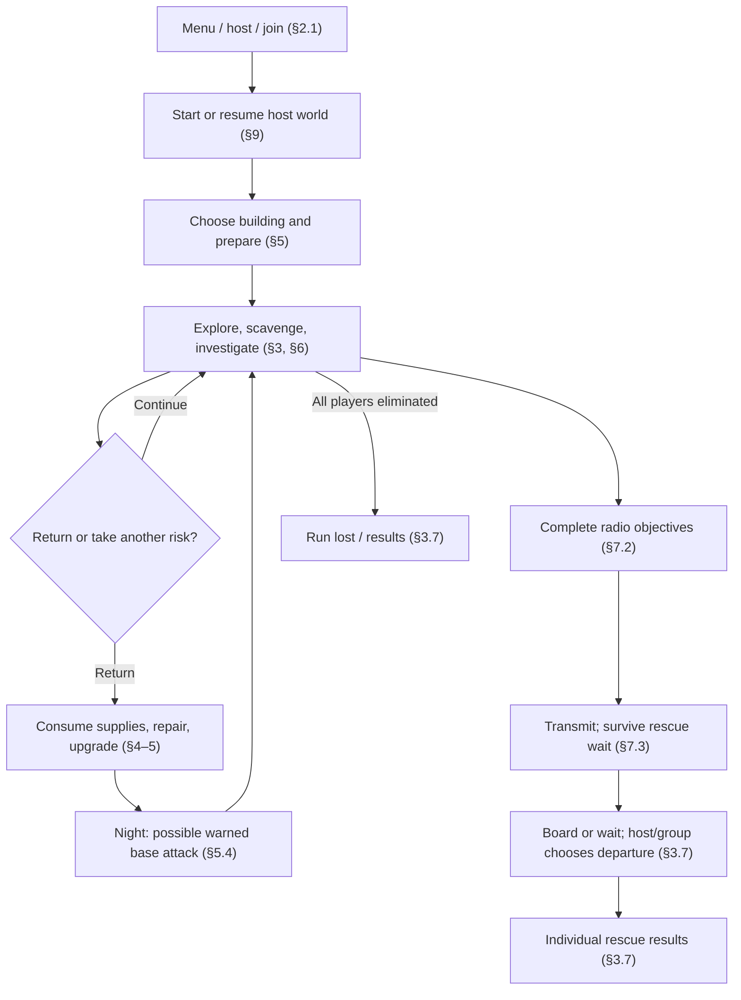
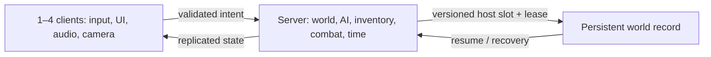
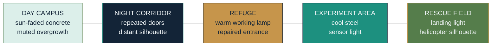

# Five Nights at Bách Khoa — Working Title

> Historical pre-migration snapshot. The single current design deliverable is [GDD.md](GDD.md); use that file for all subsequent updates.

**Consolidated game design document — proposed revision 1.0, 2026-11-02**

**Status and authority.** This is the complete proposed survival-direction GDD, assembled from the user's decisions and the team's earlier A01 material. **Selected** means explicitly chosen in the design discussion, including the five-day structure; **prototype proposal** means a concrete default added so the game can be designed and tested. Other numbers, balance and wave schedules are proposals, not measurements. This document is self-contained for review. It does not silently replace the approved A01 baseline, change the existing implementation or claim approval by the student team or course staff. CR-014 records the proposed departure from A01. The student team must review scope, reconcile affected acceptance criteria and decide formal adoption.

## 1. Concept and vision

| Field | Design |
|---|---|
| Working title | Five Nights at Bách Khoa (FNABK); retained as the user's preferred direction, final title subject to review |
| High concept | After a university behavioral-simulation experiment creates hostile Mimics and isolates the campus, 1–4 students choose a campus building as their base, survive day/night expeditions, identify impostors, and signal a rescue helicopter. |
| Genre and elements | Third-person 3D survival horror, exploration, stealth, investigation, light crafting and cooperative rescue. |
| Audience | Players who enjoy moderate horror, cooperative survival and environmental mysteries; playable without knowing the actual campus. PC keyboard/mouse; target age classification to be determined. |
| Platform and technology | Roblox on PC, 3D low-poly geometry, third-person camera, Luau; solo or online co-op for 2–4. No local split-screen. |
| Play time | Selected direction: five in-game days, with a target of approximately 1–2 real hours per completed run and host-owned saving between sessions. Not a measured result. |
| Unique appeal | Familiar university buildings are both explorable spaces and player-chosen bases; a teammate's appearance can be copied by a Mimic, while experiments create distinct creatures and machines. |
| Design constraints | Moderate, readable horror; solo completion; no real-world map-accuracy claim; low-poly performance target on Intel Iris Xe, not a measured result. |

**Experience pillars:** Make purposeful trips; weigh supplies against danger; verify rather than guess; transform a chosen campus building into a defensible base; tell the experiment's story through spaces and discoveries. Avoid gore, obligatory voice chat, mandatory multiplayer, opaque unavoidable deaths and secret-only progress gates.

**Reference analysis.** *Five Nights at Freddy's* informs anticipation and limited information; avoid relying on repeated jumpscares. *Phasmophobia* inspires cooperative observation and evidence; this game centers an explorable campus and survivor resources rather than ghost identification alone. *Don't Starve* inspires planning around day/night and supplies; use gentler needs and a finite rescue objective rather than copying its survival pressure. These are design comparisons, not asset sources. The provided [Game Dev Beginner guide](https://gamedevbeginner.com/how-to-write-a-game-design-document-with-examples/), [GitBook guide](https://www.gitbook.com/blog/how-to-write-a-game-design-document) and [beginner template](https://github.com/kosinaz/game-design-document-template-for-beginners/blob/master/docs/Game%20Design%20Document.md) informed the document's structure.

## 2. Gameplay experience and flow

A player enters a saved campus with friends or starts alone. During daylight the group chooses B1 as its first base, repairs lights and packs water. Two players travel to A3 while another searches the library; a figure resembling the fourth teammate appears, but a visible anomaly and a UV response reveal a Mimic. They return with a radio part. At night a warning precedes an attack on the barricaded entrance. After several days and a sequence of repair tasks, they send a distress call, reach the sports field and decide how long to wait for the last teammate before leaving.



### 2.1 Game application flow

Main Menu → Host / Join → New Run or Load Host Save → Lobby (1–4) → Briefing → Campus → Rescue / Defeat Results → Menu. Settings are available from menu and pause overlay; multiplayer continues while a player views menus. Host resume, invitations and slot access use Roblox-supported multiplayer facilities; no third-party backend is assumed. Leaving or closing before a successful save must not be reported as saved.

### 2.2 What makes play enjoyable

Players repeatedly make understandable tradeoffs: gather food or investigate a signal; move quietly or arrive sooner; risk a suspicious person or spend time verifying them; defend an established base or transport supplies to a better-located one. Finding an optional hidden room changes resources or understanding, never whether rescue is possible.

## 3. Player, controls and rules

### 3.1 Player definition and feedback

Each student has health, stamina, food, water, a carried inventory and limited respawns. HUD changes immediately show damage, low stamina, hunger, thirst, available interact actions and critical objective states. Positive pickups include food, water, medical items, parts and information (§4.3). No player class is required; a solo player has access to every mandatory ability.

### 3.2 Controls — prototype proposal, PC

| Input | Action | Constraint / feedback |
|---|---|---|
| WASD / mouse | Move / aim camera | Third-person, clear reticle |
| Shift / C | Sprint / toggle crouch | Stamina / quieter movement |
| E | Interact, pick up, hold to revive | Prompt, hold progress, validated range |
| Left mouse | Baton attack | Cooldown and hit/miss feedback |
| F / Q | UV stun / identity scan | Tool equipped, charge/cooldown feedback |
| 1–4 / Tab | Select carried tool / inventory and objectives | No network pause |
| R / Esc | Use medkit / menu | Reject unavailable item; settings accessible |

These keys are a design proposal, subject to remapping feasibility and testing. Text, icons and sound must not rely on color alone.

### 3.3 Player state and co-op recovery

**Prototype proposal:** 100 maximum health; at 0 the player is Downed, cannot attack and may be revived by a teammate holding E for 5 s within 6 studs. A 20 s downed window precedes elimination if not revived. Each player has **three respawns per run**, consumed on respawn, at the currently active base. In solo, reaching 0 health skips the teammate-revive wait and offers a respawn if one remains. If no base is active, a protected initial spawn is the temporary respawn point. At zero remaining respawns an eliminated player spectates. If all connected players are eliminated and none can respawn, the run is lost. These counts are untested proposals, not established behavior.

On respawn the player's carried items remain in a recoverable bag at the downed location for the rest of the run; the server keeps unique ownership. A bag inaccessible for 60 s or outside playable bounds returns to the active base storage, or to the initial spawn if no base exists. If the host leaves, the server finishes a save attempt and the session closes; failure is surfaced to the host and the previous successful save remains available. These are prototype rules to test, including disconnects and full storage.

### 3.4 Actions and interaction

Move, sprint, crouch, inspect, scan, interact, carry and transfer items, attack, use UV, repair, craft, claim a base and board the helicopter. Interactions require an alive player, server-validated distance of at most 6 studs and line of sight when applicable. A physical fuse crate can be pushed or carried and placed on a pressure plate; position and settled state matter. Keep this physics task as a proposed A01-compatible interaction unless formal review changes it.

### 3.5 Combat and mistaken identity

Baton damage to a teammate is selected to be light; prototype: 5 HP per validated hit, subject to the same attack cooldown and a 1 HP floor for teammate damage. Enemy/environment damage can still down a player. Show clear friendly-hit feedback without exposing a Mimic's identity before a hit. The server validates attacker state, possession, range, line of sight and cooldown; a client never supplies damage. This is intentional friendly fire, not an inference of the attacker's intent.

### 3.6 Rewards and pickups

| Pickup | Prototype effect | Use / risk |
|---|---|---|
| Food portion | +35 food, capped at 100 | Consumed from inventory |
| Water bottle | +40 water, capped at 100 | Refill at enabled safe source |
| Medkit | +40 health, capped at 100 | Cannot revive from inventory remotely |
| Scrap / electronics / cloth | Crafting and repairs | Occupy slots; transport when moving |
| Radio component / fuse | Advances shared rescue objective | Server-owned objective progress; lost world item is recoverable |
| Log / map clue | Lore and optional secret hint | Read without consuming essential resources |

### 3.7 Win, loss and partial rescue

Selected: a rescue helicopter lands at a campus sports field after a distress signal; each player who boards is rescued, and the group can choose to depart within a limited waiting period. **Prototype proposal:** after the signal, survive a 4-minute arrival wait; the helicopter then waits up to 3 minutes. Any boarded player can initiate departure at the onboard control; a strict majority of currently boarded players must confirm within 10 s. With one person aboard, one confirmation suffices. Boarded players can change or withdraw their vote until departure; a change to the boarded roster cancels the vote. At timeout the helicopter departs automatically. A connected player aboard at departure receives **Rescued**; connected players not aboard receive **Left Behind**. Solo boarding and departure yields **Rescued**. The group sees both individual results and whether anyone escaped; disconnected players retain a separate **Disconnected** result rather than being silently credited. These timings and the vote mechanism are proposed defaults, not yet user-selected.

The helicopter is safe to board but does not teleport unboarded players. A player can unboard before departure. If all connected players are eliminated before takeoff and cannot respawn, the run is lost. A helicopter departure with no boarded player ends in loss. Player absence, a host leaving during this sequence and final-save recovery need playtesting.

## 4. Game systems and provisional balance

All values below are **prototype proposals for a 1–2-hour run**, not playtest results. Server time is authoritative and all rates are per real second unless stated.

### 4.1 Baseline values

| Property | Start / cap | Proposal | Feedback |
|---|---:|---|---|
| Player HP | 100 / 100 | Enemy and deprivation damage; medkit +40 | HP bar, directional hit indication |
| Stamina | 100 / 100 | Sprint −22/s while moving; regen +18/s after 1 s | Stamina bar; sprint stops at 0 |
| Food | 100 / 100 | −1 per real minute while alive | Icon and numerical status at low level |
| Water | 100 / 100 | −1.5 per real minute while alive | Distinct low-water warning |
| Movement | — | Walk 12, sprint 19, crouch 7 studs/s | Animation and movement noise |
| Baton | — | 25 damage to enemy; 5 to teammate; 4.5-stud range; 0.85 s cooldown | Distinct hit and miss |
| UV | — | 13-stud range; stun 2.2 s; cooldown 14 s | Beam and timed cooldown |
| Scan | — | 12 studs, line of sight, 1 s scan, 8 s cooldown | Suspected / no anomaly found |
| Carry | 8 slots | One stack per slot; max 5 food, water or scrap per stack; objectives do not consume slots | Slot count; reject full inventory |
| Revive / respawn | 3 respawns/player | 5 s revive within 6 studs; 20 s downed window | Countdown, prompt, remaining uses |

`food_next = clamp(food - elapsed_minutes, 0, 100)`; `water_next = clamp(water - 1.5 × elapsed_minutes, 0, 100)`. At food or water 0, apply **1 HP per 10 s total**, not once per empty meter; restore either depleted meter above 0 to remove that meter's penalty, and stop damage once both are above 0. No damage accrues while eliminated or in an unloaded saved world. Starting with 100 of each, after 60 minutes without consuming items a living player has 40 food and 10 water. These values must be tuned after testing.

`stamina_next = clamp(stamina - 22 × sprint_seconds + 18 × eligible_regen_seconds, 0, 100)`; regen starts after 1 s without sprinting. Enemy damage is `HP_next = max(0, HP - validated_damage)`. Teammate baton damage is `max(1, HP - 5)` when HP is above 1; it never raises a downed player's HP.

### 4.2 Time, pacing and difficulty

**Selected direction:** The run spans five in-game days, retaining the FNABK name as the working title. Base attacks occur on some nights, grow more dangerous and give advance warning. The precise number of waves and whether rescue arrives during or after the fifth night are not yet finalized.

**Timing proposal:** A cycle has 12 minutes of day and 5 minutes of night. Five complete cycles therefore take 85 real minutes. If a playtest places the 4-minute rescue wait after the fifth night, the earliest arrival is 89 minutes, with up to 3 more minutes for boarding. This is a pacing model within the 1–2-hour target, not a measured duration or a confirmed rescue trigger.

**Wave proposal for playtesting:** A wave is one timed, warned group of attackers; there can be more than one wave in an attack night. Five days do not mean five mandatory attack waves.

| Day / night | Proposed base waves | Purpose |
|---|---:|---|
| 1 | 0 | Learn the base and supplies without an immediate siege |
| 2 | 1 light wave | Learn warning cues, defense and repair |
| 3 | 0 | Explore, move supplies and prepare; encounters outside remain possible |
| 4 | 2 waves | Test the group with a recovery interval between waves |
| 5 | 2 harder waves | Finale pressure before the proposed rescue sequence |

This is **five proposed waves across three attack nights**, not a confirmed schedule. For a two-wave night, test 30 s warning → up to 60 s first wave → 45 s recovery → 30 s warning → up to 60 s second wave. This totals 225 s of a proposed 300 s night, leaving 75 s of margin; a wave may end sooner if threats retreat or are defeated. Do not force an attack every night. Final counts, enemy mix, gaps and rescue timing require solo and 2–4-player playtests.

### 4.3 Resources, crafting and economy

There is no currency, real-money economy or trading with unknown players in this design. Materials are found on expeditions and placed in per-building storage; taking resources from a previous base requires physically carrying them. No essential key component is consumed by death. A full storage container refuses a transfer and leaves the item at its source.

| Recipe / upgrade | Prototype cost | Effect |
|---|---|---|
| Defensive repair | 2 scrap | Restore one damaged barricade by 50 HP, up to its maximum |
| Bandage | 1 cloth | Restore 15 HP; 3 s use |
| Restore a building's local power | 2 electronics + 2 scrap | Lights and existing power-dependent upgrade points function |
| Organize storage | 2 scrap | Add 8 slots at that building, once |
| Reinforce one suitable entrance | 3 scrap + 1 cloth | Install 100-HP repairable barrier; no essential exit is sealed |
| Radio repair | Objective components; no consumable | Enables signal after timing requirement |

Initial resource budget proposal: each active player starts with one food, one water and one medkit; at least four food, four water and six scrap are obtainable on accessible early routes for a solo player. Additional players receive personal starter items and +2 food/+2 water per added player distributed in shared reachable containers. Renew one food and one water at a designated canteen source each day if its stock is empty; the source is available without a secret and cannot be consumed by an offline player. Static placement, scarcity and 1–4-player balance must be tested; this is not proof of sufficient supply.

Objective stages use distinct, server-tracked components: **power fuse** (A3), **frequency record** (A2), and **radio transmitter module** (B4). Any locked or lost required physical item returns to its designated spawn after 60 s; completed stages are shared and cannot be lost with a player. Substitutes and route hints prevent a single blocked room from ending a run.

## 5. Bases, relocation and persistence

### 5.1 Base choice

Selected: **any campus building** may become the group's active base; each receives context-appropriate predefined power, storage and defense upgrades. One active base at a time is a prototype rule, not a restriction on returning to upgraded buildings. A player selects a building at its entrance; in co-op the host confirms after a 10 s announcement visible to everyone. The initial claim is free. Each base has a clear spawn point, a power point, storage and at least one defendable entrance plus an unobstructed exit. The 23-building coverage table is §7.5; this remains selected final scope even if early prototypes cover fewer buildings.

### 5.2 Moving and saved buildings

The group can relocate by confirming another building. Carried resources and items are physically moved by players; fixed upgrades remain at their original buildings and can be used again on return. Stored supplies remain in their original containers until moved. The new active respawn point activates only after the host confirms the new building; no item is teleported by the confirmation. Changes are server-owned and written to the host world save. A return to a damaged previous base retains its damaged state. Whether unoccupied bases are attacked is a prototype choice: **only the active base is targeted by scheduled attacks**.

### 5.3 Defenses and safety

Only marked suitable doors accept barricades; no barricade may close every way out or block required objectives. A barricade has 100 HP; a creature's prototype strike causes 20 damage every 2 s. At 0 it becomes an open damaged frame; a repair restores 50 HP for 2 scrap, preserving the route. Normal doors and building geometry are not destroyed by this prototype. Attacks affect doors and defensive equipment, not storage contents; survivors can recover without mandatory unique items being destroyed.

### 5.4 Night event

In the proposed wave test, 30 seconds before each wave play distinctive distant sounds, flicker an exterior warning light where electricity exists and show a text warning; sound or color is never the only cue. Enemies approach accessible entry points. Each wave ends when attackers are defeated, lose the active base or its proposed 60-second limit elapses; remaining attackers retreat rather than teleport in front of players. A proposed 45-second recovery interval separates two-wave nights. Base attacks happen **only at night**, while encounters away from the base can occur by day. Clearing an event is not required to complete an objective. Exact timing remains a playtest proposal.

## 6. Enemies, NPCs and fairness

| Threat | Selected identity / role | Prototype behavior and counterplay | Proposed balance |
|---|---|---|---|
| Mimic | Copies NPCs and player characters; moderate horror | Before aggression, two observable clues from an animation anomaly, irregular appearance or UV/scan response. Can be avoided, investigated or fought. | 75 HP; 14 studs/s chase; 20 damage; 1.6 s attack cooldown |
| Listening creature | Mutated experiment; hides, listens and ambushes | Emits a rustle before attacking. Walking/crouching reduces noise; sprinting alerts within 24 studs, walking within 12, crouching within 5. | 60 HP; 16 studs/s short pursuit; 15 damage; 2 s cooldown |
| Patrol machine | Experimental machine detects light or sound | Sweeps a visible lamp cone; avoids detection by breaking line of sight or moving quietly. A disabled lamp is visually communicated. | 90 HP; 9 studs/s patrol; 18 damage; 2 s cooldown |

Values are proposals. Machine prototype: 60° forward detection cone, range 30 studs, 1 s continuous line of sight to alert; running within 16 studs also alerts. Both sensing methods have an audio and UI cue. Creature prototype: remain hidden until it hears movement; a warning sound precedes a 1 s wind-up. All enemies use server-owned finite states and bounded pathfinding; no ML is implied. A simple state cycle is Idle/Disguise → Investigate → Chase → Attack → Search → Idle; Stunned and Defeated can interrupt active states. Lose sight for 2 s → search last known position for 6 s.

Mimics never reproduce actual chat or voice. Prototype: character-shaped nameplates are hidden beyond 8 studs, including for real players, while the party panel continues to show connected status but not precise position. A Mimic shows two clues before attacking: a repeating movement irregularity and anomalous UV reaction. At least one visual and one non-color-dependent cue are required; scanning remains optional, and an accessible solo route exists. The exact presentation needs human playtesting to avoid unfair identification.

Survivor NPCs offer notes and information; they are not required to join a fight. A shared Trust meter from A01 is **not selected for this proposed survival revision**; its eventual inclusion is an open design decision, not a claim that current Trust code is removed.

## 7. Level, objectives and content

### 7.1 Campus sketch — conceptual, not surveyed geometry

```text
                         CAMPUS / EXTERIOR
   [A2 LIBRARY] ------- [CENTRAL ROUTES] ------- [A3 LAB]
      records                |                   fuse task
                            |
   [B1 CLASSROOMS] ----- [CHOSEN BASE]* ----- [B4 RADIO]
       early supplies       |                   transmitter
                            |
   [WORKSHOPS] -------- [SPORTS FIELD] ------- [CANTEEN]
    machines & tools       helicopter           food / water

   * Any campus building can be the active base. Lines indicate intended
     gameplay connections, not verified physical distances or exact orientation.
```

The existing detached campus model is a candidate, not yet integrated into the runtime gameplay map. Keep existing building floor counts. Verify every route, staircase, door and landing zone in Studio; add hidden basements only after checking geometry and exits. No claimed real-world basement or surveyed layout.

### 7.2 Main mission stages — prototype proposal

| Stage | Location | Task / teaching | Completion |
|---|---|---|---|
| 0. Establish shelter | Any chosen building | Claim base; acquire water and food; see warning system | Base active, early supplies reachable |
| 1. Restore power | A3 | Move physical fuse crate to plate; recover shared fuse | Server records power fuse; object resets safely |
| 2. Find frequency | A2 library | Examine logs and identify evidence; optional secret shelf | Server records frequency record |
| 3. Repair transmitter | B4 | Retrieve transmitter module and activate radio | Server records module; stages 1–3 complete |
| 4. Signal | Radio point | Meet the yet-to-be-selected condition within the five-day structure, then hold E for a proposed 5 s | Distress signal accepted once |
| 5. Rescue | Campus sports field | Survive arrival wait; board before departure | Individual outcomes under §3.7 |

The sequence 1–3 may be completed in any order. Essential tasks remain possible solo and do not require an optional room, a specific base or another player. In this proposal, signaling requires all three stages plus a progression condition within the five-day structure. Whether it can happen during day 5 or only after night 5 remains undecided. Hints after a proposed 5 minutes without objective progress name the relevant zone without revealing secret rooms.

### 7.3 Example pacing

| Time / phase | Introduce / expected player decision |
|---|---|
| Day 1 | Movement, base selection, food and water; a quieter introduction |
| Day 2 | Search A3 or A2; encounter a proposed warned wave and learn repairs |
| Day 3 | Mimic clues, optional secret or patrol machine; plan the next trip |
| Day 4 | Complete remaining stages; prepare for proposed two-wave attack |
| Day 5 | Prepare the signal and landing; face proposed finale waves and rescue once the timing is decided |

This is a guide, not a requirement that the player visit buildings on a fixed day.

### 7.4 Secrets and content inventory

| Content | Planned scope | Role |
|---|---|---|
| A2 hidden archive | 1 optional room | Experiment log and supplies; never sole frequency record |
| A3 concealed basement | 1 optional area | Power-related story and extra repair materials; safe return route |
| B1 blocked classroom | 1 optional room | Survivor note and supplies |
| Enemy archetypes | Mimic, listening creature, patrol machine | Distinct threats (§6) |
| Basic items | Food, water, medkit, cloth, scrap, electronics, baton, UV, scanner | Survival, defense and repair |
| Objective items | Fuse, frequency record, transmitter module | Shared radio stages with recovery |
| Rescue | 1 helicopter and sports-field landing site | Individual rescue outcome |

At least two independent environmental hints lead to each optional entrance. Propose a visible difference in the room and a document clue; no secret is required for rescue. A room has an unobstructed exit, and a player can return without a second player.

### 7.5 Base coverage — all 23 buildings

These are **planned upgrade profiles**, not statements that the existing models already support them. Each row requires a power point, storage point, defendable entrance, safe spawn and tested exit; exact room/door IDs are assigned during implementation.

| Buildings | Contextual power / storage / defense profile |
|---|---|
| A1, A4, A5 | Classroom lighting / classroom cabinets / suitable corridor doors |
| A2 | Reading-hall lighting / library storage / suitable archive or hall entry |
| A3 | Lab power / equipment cabinets / lab or corridor entry; preserve puzzle route |
| B1, B2, B3 | Classroom lighting / room cabinets / selected corridor entrances |
| B4 | Technical power / parts cabinets / technical-room entry; preserve radio access |
| B6, B8, B9 | Classroom lighting / shared cabinets / selected entrances |
| B11, B12 | Academic lighting / classroom storage / selected entrances |
| C1, C2, C3 | Workshop power / tool cabinets / suitable workshop shutters and exits |
| C4, C5, C6 | Academic or practical-room power / cabinets / selected entrances |
| Facility7 | Existing service lighting / service storage / suitable entry |
| KioskOISP | Local lighting / compact storage / suitable entry |
| Canteen | Kitchen lighting / pantry storage / service entrance; food source stays accessible |

Count: A1–A5 (5), B1–B4/B6/B8/B9/B11/B12 (9), C1–C6 (6), Facility7, KioskOISP and Canteen (3) = **23**. All 23 are selected final-scope base candidates; suitability and placement are not yet verified. A prototype with one candidate is a milestone, not a replacement for the complete direction.

## 8. Narrative, world and characters

**Setup:** An HCMUT-inspired campus is isolated after a behavioral-simulation experiment creates Mimics and fails. The student survivors search for communications equipment while evidence reveals what happened. Experimental creatures and machines present distinct threats. This is fictionalized and must not imply real people conducted the events.

**Story delivery:** briefing at start; environmental clues in classrooms and labs; short readable logs, visual damage and optional conversations; objective discoveries reveal enough context without requiring secret rooms. Proposed beats: discover isolation → learn the signal can work → find conflicting accounts of the simulation → restore transmission → choose who to wait for at rescue. No fixed culprit or ending explanation is approved yet.

| Character | Function | Status |
|---|---|---|
| Student player | Survivor, investigator and base planner | 1–4 players |
| Survivor NPC | Provides clues or optional supplies | Proposed; no real-person likeness |
| Mimic | Impersonates NPC or player | Selected threat |
| Listening creature | Ambushes based on sound | Selected behavior, identity proposed |
| Patrol machine | Detects using light or sound | Selected behavior, model proposed |
| Rescue team | Responds to signal and operates helicopter | Identity and dialogue open |
| Blue Professor | Optional fictional nonblocking cameo from A01 | Retain only subject to revision review; not necessary to rescue |

## 9. Save, session and networking

Selected: the host owns the saved world and reopens it for friends. **Prototype proposal:** three host save slots; autosave at dawn, after an objective, after a confirmed base change and immediately before departure; host can request save at the active base. Save progress, game time, objective flags, base and all building upgrade states, per-building storage, world pickup ownership, player inventories, respawns and identity of connected participants. Transient enemy positions reset to safe spawn points when resuming; a pending night event restarts with its full warning rather than resuming a half-finished attack.

The server makes changes atomic within a world record, serializes conflicting item operations, associates guests with stable account identifiers and prevents the same host slot from running in two servers with a session lease. Guest items remain associated with that guest while absent. A failed save is visible; never replace the previous successful record with a partial write. Define capacity, schema versions, lease expiry, platform service limits and retry policy during implementation. No persistence or four-player support is claimed to exist today.



Only the server grants items, applies friendly-fire damage, changes base ownership, upgrades, day/night, enemy state, rescue and player results. Validate target, distance, line of sight, ownership, capacity, cooldown and state. Dedicated tests must cover simultaneous pickup, duplicate transfer, hostile forged requests, disconnect mid-move, failed saves, stale leases and rejoining with different party sizes.

## 10. Art, audio and UX

### 10.1 Visual direction and compact mood board

| Visual tile | Intended image / material | Color and mood |
|---|---|---|
| Day campus | Sun-faded concrete classrooms, open galleries, restrained overgrowth | Warm paper and muted foliage; safe enough to plan |
| Night corridor | Repeating doors, long low-contrast shadows and a readable distant figure | Dark navy, selective teal highlights; suspense without black screens |
| Refuge | Functional lamps, repaired doors, labeled storage and improvised barricade | Warm amber over cool walls; signs of human activity |
| Experiment area | Lab equipment, warning stripes and a patrol machine's visible scan | Cool steel, mint status light, amber warning |
| Rescue | Open sports field, landing light and helicopter silhouette | Bright focal point against a dark perimeter |

This is a concept mood board and art brief, not commissioned images or external asset permission:



Prefer native parts and original, licensed low-poly assets; no asset upload or publication without the applicable explicit approval. Avoid copying recognizable game characters or real people's likenesses.

### 10.2 Style and palette

| Swatch | Hex | Use |
|---|---|---|
| Night navy | `#132437` | Night backgrounds and silhouettes |
| Campus teal | `#1D907F` | Interactive equipment, subdued accents |
| Paper blue | `#F1F5F7` | Text and readable light surfaces |
| Mint | `#DCEFEA` | Safe UI / status indicators |
| Amber | `#C6954B` | Warnings and warm refuge lighting |
| Muted foliage | `#557D4B` | Campus vegetation |

Angular, non-graphic shapes; readable entrances and silhouettes; light and shadow support navigation rather than obscure it. Avoid flashing as a required cue. Target PC Iris Xe at ≥30 FPS as a **goal**, to be measured at realistic 1–4-player loads.

### 10.3 HUD and menu mockups

```text
HUD (concept, not final scale)
+--------------------------------------------------------------+
| DAY 3  16:20     OBJECTIVE: Recover transmitter     [Map]    |
| TEAM: An [HP]  Binh [HP]  Chi [HP]  Dung [HP]              |
|                                                              |
|                         +  interact prompt                   |
|                                                              |
| HP [########--] STAMINA [#######---] FOOD [###-] WATER [##-] |
| 1 Baton | 2 UV | 3 Scanner | 4 Medkit     BAG 5/8           |
+--------------------------------------------------------------+
```

```text
MAIN MENU                  LOBBY / HOST SAVE
+------------------+       +----------------------------------+
| New / Load       | --->  | Host slot: Campus A  [Load]      |
| Join friend      |       | Party: 1/4     [Invite] [Start] |
| Settings         |       | Saved: Day 3  Last save: ...     |
| Credits / Exit   |       +----------------------------------+
+------------------+
```

Interaction and status UI must remain legible at the user's chosen resolution; support volume, sensitivity and reduced-jumpscare options. Team indicators communicate health/state without acting as guaranteed real-time positional identity verification. Do not fake a real person's chat or voice.

### 10.4 Audio and music list

| Asset | Cue / purpose | Priority |
|---|---|---|
| Campus day ambience | Wind, vegetation and distant school structures | Core |
| Night ambience | Sparse wind, distant movement; preserve important cues | Core |
| Footsteps by surface | Concrete, grass, stairs; distinguish sprint/crouch | Core |
| Mimic tell / reveal | Non-verbal anomaly and distinct reveal cue | Core |
| Creature rustle / ambush | Warn before wind-up | Core |
| Machine sweep / alert | Motor, sensor sweep and detection escalation | Core |
| Base attack warning | Distant threat and UI cue 30 s before attack | Core |
| Baton, UV, scanner | Separate hit/miss, beam and result feedback | Core |
| Repair / crafting / pickup | Confirmation and failure cues | Core |
| Radio / helicopter / result | Signal acknowledgement, approach, boarding, win/loss | Core |
| Music | Quiet exploration, escalating attack, rescue and results loops | Planned; optional in first slice |

All sounds need volume controls; important feedback also has visual or text equivalents. Asset authorship and licensing must be recorded before release.

## 11. Technical and production plan

### 11.1 Engine and architecture

Roblox Studio and Luau provide the existing project, multiplayer runtime and native geometry workflow. Use server-authoritative modules for world clock, inventory/storage, base selection/upgrades, objective/rescue state, AI and combat, and host save data. Clients provide camera, input, audio/VFX and HUD. Rojo maps local sources into Roblox services; the detached Studio map must be deliberately integrated and saved, not assumed to sync automatically. No external asset uploads or publishing are authorized by this design document.

Existing A01 prototype includes server-owned Mimic, baton, UV, scanner, three-key objectives and a two-player-oriented life cycle; these are reuse candidates, not proof of the new systems. Four-player life state, persistence, survival and base relocation need implementation and tests. Profile both the campus scene and runtime AI before optimizing or promising FPS.

### 11.2 Asset plan

| Asset group | Minimum planned assets | Source / status |
|---|---|---|
| Campus | 23 existing preview buildings, lawns, roads, gates and sports field | Local preview; integration and verification pending |
| Bases | 23 sets of compatible power, storage, defense and spawn points | To author and test in each building |
| Secrets | A2 archive, A3 basement, B1 classroom | To author with clues and safe exits |
| Characters | Student avatar, survivor NPC, Mimic disguise | To author / adapt; permissions and rights to review |
| Enemies | Listening creature and patrol machine | To author; no assets generated by this document |
| Props | Food, water, medkit, materials, crate, radio, barricade and helicopter | Reuse only where verified; otherwise create natively or license |
| UI and audio | HUD, inventory, menus, warnings and cue list (§10) | To design, implement and license |

### 11.3 Scope and milestones

**Full selected direction:** all 23 buildings can serve as bases; 1–4 players; host-owned save and resume; multi-day survival; food/water; Mimic and the two additional threat categories; night attacks; simple crafting/repairs; optional secrets; distress signal and helicopter rescue. This is ambitious and must not be represented as complete.

**Prototype MVP, deliberately smaller:** one representative base and nearby expedition building, host/solo first, basic food/water, one inventory item, one Mimic, a simple day/night transition, one optional hidden room and a radio-preparation task. This is only a validation slice; all-building selection, additional enemy categories, persistent multiplayer and full rescue remain required for the selected full direction.

| Milestone | Deliverable / exit evidence | Ownership (planned, verify with team) |
|---|---|---|
| M0 | Review this GDD, approve CR-014 and reconcile A01/course requirements | Entire student team |
| M1 | Graybox one route and base with one Mimic; demonstrate a traceable Chase/Search transition | Lê Hoàng Chí Vĩ: level/UX; Vũ Hải Tuấn: integration; Chu Nguyễn Tuấn Anh: AI |
| M2 | Validated baton combat, survival pickup and a basic day/night transition | Vũ Hải Tuấn: gameplay/physics; Chu Nguyễn Tuấn Anh: server validation |
| M3 | Inventory, repair and base relocation prototype; solo no-softlock tests | Vũ Hải Tuấn and Chu Nguyễn Tuấn Anh |
| M4 | Host save/resume, 2–4 players, disconnect and duplication tests | Chu Nguyễn Tuấn Anh, supported by Vũ Hải Tuấn |
| M5 | All 23 base profiles, other threats, secrets and rescue flow | Lê Hoàng Chí Vĩ: level/UX; team: systems and QA |
| M6 | Art/audio, accessibility, target-device profile, playtests and handoff | Entire student team |

Names and roles are A01 workstream proposals, not evidence of work completed or confirmed assignments. Durations and deadline are intentionally not invented; the team must schedule after assessing capacity.

### 11.4 Risks and mitigation

| Risk | Mitigation / acceptance evidence |
|---|---|
| 23 buildings and 4-player scope | Incremental slice, then checklist each base; do not claim full coverage early |
| Item duplication or failed save | Server validation, atomic records, lease and failure-injection tests |
| Mimic unfairness or teammate griefing | Two clear clues, accessible feedback, light capped damage, observe playtest results |
| Rescue becomes impossible | Mandatory item recovery, accessible alternate routing, solo playthrough |
| Preview performance / navigation | Natural traversal, AI pathfinding and measured 1–4-player hardware profiling |
| A01/course mismatch | CR-014 and explicit team/course review before replacing baseline |

## 12. Verification and rubric coverage

All checks below are **planned, not passed**. Manual Roblox Studio test steps and expected results:

1. **Solo start to rescue:** Start a new world, choose a base, collect food and water, complete all three radio stages without entering a secret, meet whichever progression condition is configured for the test, signal, wait and board. Expected: all steps can be completed alone; only the boarded player receives Rescued; no mandatory item becomes irretrievable.
2. **Co-op and friendly fire:** With 2 and then 4 clients, attack a real teammate once and observe light server-applied damage; identify a Mimic using two clues; down and revive a teammate, then exhaust one respawn. Expected: no client-selected damage, timely feedback, coherent shared state and no forced multiplayer puzzle.
3. **Bases:** Claim every one of the 23 buildings in turn; operate one power, storage and defensive upgrade; move supplies to a second building and return. Expected: fixed upgrades and stored items remain where left, spawn points and routes remain usable, supplies are not teleported or duplicated.
4. **Nights:** Run both a quiet and an attack night. Expected: warnings precede attacks, base attacks occur only at night, defenses can be damaged and repaired, exits remain usable.
5. **Save/rejoin:** Save as host with changed time, base, items and objective flags; stop and reopen with absent and returning guests. Interrupt a transfer and simulate a save failure. Expected: last successful save loads, each item has exactly one owner/location, failed saves are reported.
6. **Rescue and UI:** In 2–4 clients board only some players, choose departure and repeat at timeout. Expected: individual outcomes match the boarding state; prompts, low-needs indicators, sounds and accessibility options remain understandable.
7. **Map and performance:** Walk each route and secret entrance at player height and measure frame rate on target hardware with realistic NPC and player counts. Expected: no stuck routes or illegible cues; report observed FPS without claiming the ≥30 FPS goal until measured.

| Rubric | Where addressed |
|---|---|
| 1.1 Concept & vision | §1 |
| 1.2 Core gameplay & mechanics | §2–3, flowchart and controls |
| 1.3 Systems & balance | §4–6, numeric tables and formulas |
| 1.4 Level & content | §7, map sketch, pacing and 23-building coverage |
| 1.5 Narrative & characters | §8, with story linked to §7 objectives |
| 1.6 Art, audio & UI/UX | §10, textual mood board, palette, wireframes and audio list |
| 1.7 Technical & production | §9 and §11, architecture, assets, scope and milestones |
| 1.8 Quality & consistency | Defined terminology, proposal labels, traceable flow and open decisions (§12–13) |

## 13. Decisions, ownership and change control

**Selected by user:** five-day survival, retaining FNABK as the working title; 1–4 players; host-owned persistence; 1–2-hour target; moderate food/water drain and horror; Mimics copying NPCs and players; light friendly fire; experimental patrol machines and ambushing creatures; any campus building as a movable base with retained fixed upgrades; warned night-only base attacks; limited respawns; signal and helicopter rescue with individual outcomes.

**Proposed for team review:** all concrete numbers; 5-phase pacing and timing; radio stages; inventory slots and recipes; AI sensor ranges; base confirmation and respawn details; save schema and cadence; landing site's exact geometry; boarded-player departure vote and timeout behavior; final scope and roles. Illustrative reference names, UI and sketches are not final assets. Team members remain responsible for understanding and defending all AI-assisted work.

**Open decisions requiring review:** final title confirmation; the exact number, enemy mix and spacing of waves; whether the helicopter arrives during day 5 or after night 5 and the signal's prerequisites; experiment purpose and exact cause; survivor cast and Trust; number and placement of enemy encounters; absence/disconnection at rescue; co-op departure voting; repair and resource balance; accessibility, localization and real asset licensing. See CR-014 for impact on A01 AC-01–AC-11; do not relabel current tests as passing this new design. Update the course-approved baseline and machine-readable spec only after the appropriate review.
